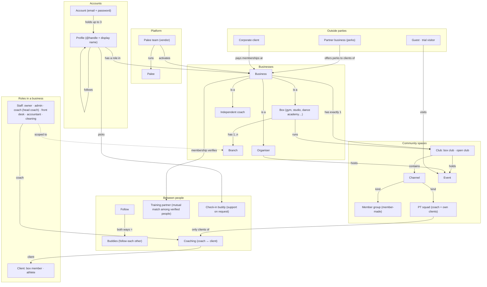
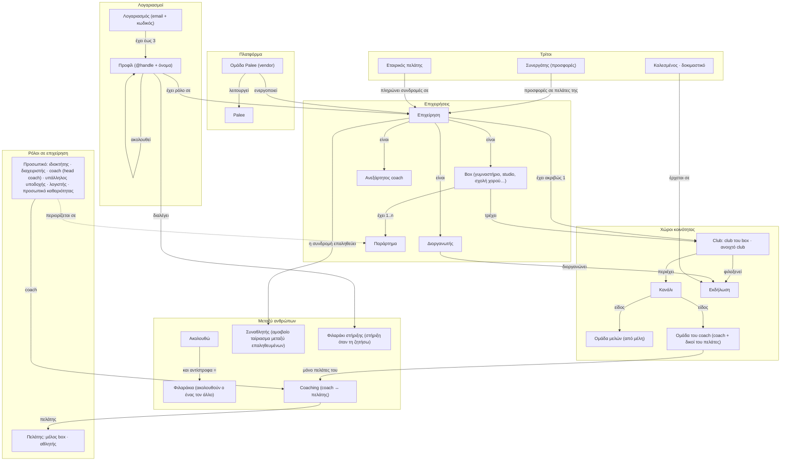

# Palee ontology: canonical terms (English · Ελληνικά)

Status: **draft, 2026-10-25**, waiting for ANR's choices in §5. Once approved it is the
source of truth for every name in the UI, the docs and code comments; the code keeps its
table and module names (column «Code»), which never appear in the UI.

How to use it:
- One thing, one name, in each language. If a screen needs a name that is not here, add it
  here first.
- «Not to be confused with» lists the near names that caused confusion so far.
- Greek uses the English loanword only where Greek users already say it (Box, club, coach, PR, WOD).
  Abbreviations that Greeks don't use (PT) and words they don't know (squad) are written in Greek.
- A person's role is always a word for the person, never the department (λογιστής, not «Λογιστήριο»).
- Never write a bare "member" / «μέλος»: always say what of (box member, club member).

## 1. The layers at a glance

1. **Platform**: Palee and the Palee team.
2. **Accounts and profiles**: who signs in, and who they appear as.
3. **Businesses**: the providers people train with (box, independent coach) and event organisers.
4. **Inside a business**: branches, roles, staff, clients, plans.
5. **Community spaces**: clubs and the channels inside them.
6. **Person-to-person relations**: follows, buddies, training partners, check-in buddies, coaching.
7. **Conversations**: everything in Μηνύματα.
8. **Outside parties**: partner businesses (perks), corporate clients, guests.

## 2. Graph (English)

## 3. Γράφος (Ελληνικά)

## 4. Glossary

Terms marked **(proposed)** change today's wording; see §5. Everything else matches the app.

### 4.1 Platform and accounts

| English | Ελληνικά | Code | What it is | Not to be confused with |
|---|---|---|---|---|
| Palee | Palee | `Palee` | The app and the company behind it. | Hosted at palee.app; the infrastructure was renamed too (TD-109). |
| Palee team | Ομάδα Palee | `vendor` role, `/platform` | The people who run Palee: activate businesses, set plans, handle password resets. Shown as "Palee" to users. (ADR-089) | Business owner. "Vendor" is a code word only. |
| Account | Λογαριασμός | `logins` | One email and one password. Holds up to 3 profiles. (ADR-187) | Profile. |
| Profile | Προφίλ | `users` | Who you appear as: unique Latin **@handle** plus a free **display name**. Everything social and every role hangs on a profile. | Account. |
| Mock person | Εικονικό άτομο | `users.demo_organization_id` | A fake member created for a business in demo mode. Never visible outside it. (ADR-184) | Trial visitor, guest. |

### 4.2 Businesses

| English | Ελληνικά | Code | What it is | Not to be confused with |
|---|---|---|---|---|
| Business | Επιχείρηση | `organizations` (tenant) | Umbrella for anyone who runs things on Palee. Each has one kind below, a slug, a club and a plan. Demo until the Palee team activates it. | "Organization", "provider", "tenant" are code words. |
| Box | Box | `provider_kind: gym` | A place people train at: gym, CrossFit box, studio, **dance academy**, martial-arts school. What it offers is described by discipline tags, not by a separate kind. | Club (the box's community space). **(proposed)**: one word, "Box", replaces "Gym" / «Γυμναστήριο» in member screens. |
| Independent coach | Ανεξάρτητος coach | `provider_kind: coach` | A coach with their own clients and no box (the solo-coach tier, ADR-170). Same person can also be staff at a box. | **(proposed)** replaces "Personal coach", "Solo coach", «Προσωπικός coach», «Ανεξάρτητος προπονητής». |
| Organiser | Διοργανωτής | `provider_kind: organiser` | The hidden one-person business created when someone hosts an event «Ως εγώ». (ADR-185) | Co-host. |
| Co-host | Συνδιοργανωτής | `event_cohosts` | Another business that agrees to co-run an event. | Organiser. |
| Branch | Παράρτημα | `facility_locations` | One physical location of a box. Staff can be limited to some branches. (ADR-186) | **(proposed)** replaces «Κατάστημα», which also means the e-shop. |
| Branch manager | Υπεύθυνος παραρτήματος | role preset | Admin rights limited to chosen branches. | Owner. |
| Space | Χώρος | `spaces` | A room or area of a branch (or of the whole box): where classes take place, what the cleaning staff clean, where the equipment stands. Can be made unavailable for a time. (ADR-202) | Branch («Παράρτημα», never «Χώρος»); Club and community spaces (§4.4). Was "cleaning area". |
| Floor plan | Κάτοψη | `space_floor_plans` | An image of one floor of a branch, with the spaces drawn on it. A branch can have several. (ADR-202) | Map (Around). |
| Room photos | Φωτογραφίες χώρου | `space_photos` | Photos of a space to get an idea of it; each one is on the public box page only when its uploader turns it on (🌐). (ADR-290) | Cleaning points. |
| Cleaning point | Σημείο καθαριότητας | `space_cleaning_points` | A photo of a part of a space and what to clean there. The cleaning staff answer each one «Καθαρό» / «Δεν καθαρίστηκε» (with a note). (ADR-290) | Room photos; cleaning tasks (the text checklist). |
| Plan (Palee) | Πακέτο Palee | `platform_plans` | What a business pays Palee. | Subscription package (what clients pay the business). |
| Subscription package | Πακέτο συνδρομής | `membership_packages`, `package_type` | What a client buys or is given by a box: recurring membership, visit pack, trial, season, corporate. Always the full name, never a bare "package" / «πακέτο». Trial type: "Trial" / «Δοκιμαστικό» (never «Δίκη»). | Plan (Palee), personal training package. |

### 4.3 Roles inside a business

| English | Ελληνικά | Code | What it is |
|---|---|---|---|
| Staff | Προσωπικό | staff roles | Anyone with one of the roles below. Opens the console by default; «Διαχείριση» switches back from the social app. |
| Owner | Ιδιοκτήτης | `owner` | Everything, always all branches. |
| Admin | Διαχειριστής | `admin` | Runs the business; can be branch-scoped. |
| Coach | Coach | `coach` | Leads classes, coaches own clients. |
| Head coach | Head coach | `coach_scope: all` | A coach who sees and coaches every client, not only their own. |
| Front desk | Υπάλληλος υποδοχής | `front_desk` | Check-in, bookings, selling packages at the desk. (ADR-102) |
| Accountant | Λογιστής | `accountant` | Money only. |
| Cleaning staff | Προσωπικό καθαριότητας | `janitor` | The cleaning log only. |
| Client | Πελάτης | member or athlete role | Someone who trains with the business. Umbrella word for the two below. |
| Box member | Μέλος box | `member` | Client of a box with a membership or package. Where the box is known, name it: "Member of Box Kypseli" / «Μέλος στο Box Kypseli». Never a bare "Member" / «Μέλος». |
| Former box member | Πρώην μέλος box | `left_at` on `organization_memberships`; status `former` | Someone who left the box (ADR-595). While a package they kept still runs their status reads "Left" / «Αποχώρησε»; once it ended, "Former box member" / «Πρώην μέλος box». They see «Δεν είσαι μέλος» in Box. | Unfollow (leaving does not unfollow); status «Ακυρώθηκε» (a staff override). |
| Athlete | Αθλητής | `athlete` | Client who gets **personal programming** from a coach. |
| Guest | Επισκέπτης | `guest` | Someone with a Palee account whom staff made a guest of the box at the desk, so they can buy a membership package, a free sale or a shop order there. The lowest client tier; one person can be a guest of many boxes. Sees no member app of the box, only the public box page with «Γίνε μέλος box». Never self-chosen. (ADR-272) |
| Personal link | Προσωπικός σύνδεσμος | `registration_invitations` | One-time invitation for one person, any role including staff. |
| Join links | Σύνδεσμοι εγγραφής | `organization_settings.join_link` | Public links, one per client role, each on or off on its own: «Σύνδεσμος για μέλη box» (`/join/<slug>`) and «Σύνδεσμος για αθλητές» (`/join/<slug>/athlete/<key>`). The link sets the role, never the visitor. (ADR-216) |

### 4.4 Community spaces

| English | Ελληνικά | Code | What it is | Not to be confused with |
|---|---|---|---|---|
| Club | Club | `community_clubs` | A space with club members («μέλη club»), a feed, channels and events. Shown as a bubble in the club bar. | Box (the business). |
| Box club | Club του box | `kind: gym` | Every business has exactly one. Its members are the box's active clients; its staff are the box's staff. Named after the box. | |
| Open club | Ανοιχτό club | `kind: open` | A club staff create for a theme (e.g. Saturday trail runs). Anyone who belongs to or follows the box can join or ask to join. | Group. |
| Channel | Κανάλι | `community_channels` | A stream of posts inside a club: #ανακοινώσεις, #wod-σήμερα, #challenges, a class's channel, a season's channel. | Conversation (Μηνύματα). |
| Member group | Ομάδα μελών | `channel kind: member_group` | A channel members propose inside their box's club; has its own admins. | Open club (staff-made, its own bubble). |
| PT squad | Ομάδα του coach | `channel kind: pt_squad` | A coach's private channel with up to 30 of their own clients. Greek formerly «PT squad». (ADR-168) | Member group, class. |
| Class channel | Κανάλι τμήματος | `channel kind: class_slot` | The channel of one class on the schedule. Formerly «ομάδα τάξης», «Κανάλι μαθήματος». | Member group. |
| Personal training | Προσωπική προπόνηση | `pt_pack`, appointments | One-to-one sessions with a coach, sold as personal training packages («Πακέτο προσωπικών προπονήσεων»). "PT" is never written in Greek. | Class. |
| Online programming | Online προγραμματισμός | `online_coaching` (package module) | A package service where a coach sends personal training plans and, optionally, messages, check-ins, technique video reviews and a nutrition plan, all remotely. Formerly "Online coaching" / «Online καθοδήγηση»; the code key stays `online_coaching` because saved packages store it. | Personal training (in person), Coaching (the coach ↔ client relation). |
| Event | Εκδήλωση | `community_events` | A one-off or weekly happening with places, price and attendees. Run by a club or an organiser. | Class (on the schedule). |
| Class | Τμήμα | `class_slots` | A scheduled session on the box's timetable, booked with a subscription package. The code's "slot" is never shown: a class is never «slot», «θέση», «τάξη», «κλάση» or «κουλοχέρης». | Event, class type (Τύπος τμήματος). |
| Recurring class | Επαναλαμβανόμενο τμήμα | `class_series` | A class that repeats on a pattern (formerly "series"). The form's start time is "Class start time" / «Ώρα έναρξης τμήματος». | Season. |
| Trial class | Δοκιμαστικό τμήμα | `trials` | A newcomer's free class. Short form «Δοκιμαστικό». A trial period of a plan is «Δοκιμαστική περίοδος». | Guest. |
| Day WOD | WOD ημέρας | `day_workouts` | The WOD set for a whole date: every class (τμήμα) of that day, or only chosen class types (and, with branches, one branch), takes it unless the class has its own WOD. (ADR-230) | A class's own WOD (an override); «WOD σήμερα» (the club channel). |
| Workout type | Τύπος προπόνησης | `master_workouts.type`, `WorkoutType` | The kind of training a WOD is (CrossFit, Πυγμαχία, Χορός …): one fixed list for the platform, grouped in families (Λειτουργική & CrossFit, Δύναμη, Γυμναστική & σωματικό βάρος, Αντοχή, Σώμα & νους, Μαχητικά αθλήματα, Χορός, Υπαίθριο, Αποκατάσταση) that stats, badges and colours read. The box chooses which ones its editors offer (Ρυθμίσεις › Τύποι προπόνησης). (ADR-275) | Class type (Τύπος τμήματος): the box's own list for its timetable, bookings and credits. |
| Class level | Επίπεδο | `class_types.levels` (`beginner`, `intermediate`, `advanced`) | The levels a class type suits: «Αρχάριοι», «Μεσαίοι», «Προχωρημένοι», one or more; none chosen is shown as «Όλα τα επίπεδα». It informs and filters, it never blocks a booking. (ADR-490) | Scale level (Rx/Scaled), XP level, rank, Partners level («Αρχάριος / Μέτριος / Προχωρημένος» of a person). |
| Event class type | Εκδήλωση | `class_types.kind: event` | A class type whose bookings use the package's event visits, for seminars, workshops and open days. Set under «Προχωρημένα». (ADR-097, ADR-490) | Event (`community_events`) of a club or organiser. |

### 4.5 Relations between people

| English | Ελληνικά | Code | What it is | Not to be confused with |
|---|---|---|---|---|
| Follow / follower | Ακολουθώ / ακόλουθος | `community_follows` | One-way. Instant for public profiles (the default), a request for private ones. | |
| Follower invite | Πρόσκληση ακολούθου (button «Προσκάλεσε») | `organization_follower_invites` | A box invites someone who follows it and is not a box member to become one: a notification and a message from the box. «Όχι, ευχαριστώ» stops further ones from that box; otherwise the box may invite the same person again after 90 days. People choose in Ρυθμίσεις whether boxes they follow may invite them (on by default). (ADR-580) | Invitation (email, ADR-209); join request (ADR-552). |
| Buddies | Φιλαράκια | derived: mutual follows | Two people who follow each other. Can message each other anywhere. (ADR-193) | Check-in buddy. |
| Training partner | Συναθλητής (plural «Συναθλητές») | `partners` context | A match between two verified adults anywhere on Palee who both said yes, to train together («Κλείστε μαζί»). One public deck, opened from Γύρω μου. (ADR-169, ADR-280 from 2026-10-30; it was one deck per club before) | Partner business; Buddies. |
| Check-in buddy | Φιλαράκι στήριξης | `buddy_links` | One or two people you pick to hear from you when you ask for support (cravings, motivation); can get your weekly summary. (ADR-160) | Buddies (mutual follow). |
| Coaching | Coaching | `coaching_relationships` | A coach and a client at one business. Decides what the coach sees and who can join their PT squad. | Follow. |
| My clients | Οι πελάτες μου | coach view | The coach's list of active coaching clients (Box › Πελάτες μου). | Members of the box. |
| PR sharing | Κοινοποίηση PR | `pr_sharing_grants` | A person lets a specific person see all their PRs. | Follow. |
| Media (profile tab) | Πολυμέσα | `GET /api/people/:id/media` | The profile tab with a person's photos and videos: a grid of their profile posts that carry media, under the same audience as the posts. There are no separate «reels»: a video is a post with a video. (ADR-231) | Αναρτήσεις (every post, text included). |

### 4.5a Training partners (ADR-280)

| English | Ελληνικά | Code | What it is | Not to be confused with |
|---|---|---|---|---|
| Training partners nearby | Συναθλητές κοντά σου | Γύρω μου card → `/partners` | The Γύρω μου card that opens the deck. Hidden when there is nothing to show. | The club page's Μέλη tab (no Partners there any more). |
| Deck | Κάρτες | `GET /me/partners/deck` | The full-screen cards of verified people to swipe. | Feed. |
| Partners verification | Επαλήθευση | `partner_verifications` | Done once per account, never lapses with a subscription: by an active membership (box or independent coach) or by two sponsors plus the Palee check. Lost only by a suspension. | A box checking a member at the door (check-in). |
| Sponsor | Εγγυητής | `partner_sponsorships` | A person verified through a membership who vouches that they know the candidate. At most 5 in 30 days. | Buddy; referral («Φέρε φίλο»). |
| Vouch | Εγγυώμαι | `vouch` | What a sponsor does. The request reaches them from the candidate's Φιλαράκια list or a single-use QR/link (10 minutes). | Follow. |
| Palee check | Έλεγχος από την ομάδα του Palee | `partner_verification_requests` | Sponsor path only: an SMS code to a mobile number, then a selfie holding a 4-digit code, compared with the avatar by a person of the Palee team. No face recognition. | Identity check with an ID card (not done). |
| Badge | Σήμα | `badge` | On the card: «✓ Μέλος <box>», «✓ Μέλος box», «✓ Επαληθευμένος», «✓ Με εγγυητές». | Achievement badges (Pantheon). |
| Partners report | Αναφορά | `partner_reports` | A report on a person in Partners, decided by the Palee team (platform console «Αναφορές Συναθλητών»), never by box staff. Also blocks. | Club report (ADR-143, box staff). |

### 4.6 Conversations (Μηνύματα)

| English | Ελληνικά | Code | What it is |
|---|---|---|---|
| Conversation | Συνομιλία | `person_conversations` | Two people, anywhere on Palee. |
| Message request | Αίτημα μηνύματος | `folder: requests` | A first message from someone you have no relation with. |
| Group chat | Ομαδική συνομιλία **(proposed name)** | `messaging_threads` box/class | The box's thread and each class's thread. Today they sit under the «Clubs» tab. There is no user-made group chat yet. |
| Coach chat | Συνομιλία με coach | thread with a coach / assignment | Chats about your training with your coach; the «Coach» tab. |
| Training partner chat | Συνομιλία συναθλητών | partner match thread | Opens when a training-partner match happens. |
| Check-in buddy chat | Συνομιλία στήριξης | buddy support thread | Opens when a check-in buddy answers a support request. |
| Box conversation | Συνομιλία με το box | `messaging_threads` context `box` (ADR-282) | Anyone with an account and one box. The person writes on `/b/:slug/chat`; the box answers as itself. «Επικοινωνία με το box» opens it. |
| The box's inbox | Εισερχόμενα του box | capability `message_from_box` | Everyone who answers for the box (owner, admin, front desk, accountant), in Μηνύματα › Box. Filters «Αναπάντητα» and «Όλα». |
| Newcomer | Νέος | `box_person.newcomer` | Someone writing to a box who is not, and was never, its client. Waits for an answer after three messages; may be blocked («Αποκλεισμός»). |
| Bring in a coach | Φέρε τον coach | `joined_as: coach` | The inbox adds a coach of the box to one conversation; the topic «Προπόνηση» adds the person's coaches by itself. |
| Topic | Θέμα | `messaging_messages.topic` | Κράτηση, Πληρωμή, Συνδρομή, Προπόνηση, Χώρος. |

### 4.6b Text messages from the box (ADR-348..351, ADR-368/369)

Outside the app: SMS today, Viber and WhatsApp later. Push stays first; these go only where
push is not enough.

| English | Ελληνικά | Code | What it is | Not to be confused with |
|---|---|---|---|---|
| Text message (SMS) | Μήνυμα SMS | `channel_messages` channel `sms` | A message the box sends to a person's mobile, outside the app. | Message («Μήνυμα») in Μηνύματα, which stays in the app; push notification. |
| Messaging channel | Κανάλι μηνυμάτων | `channel` (`sms`, `viber`, `whatsapp`) | How a text message travels. Only SMS is switched on today. | Club channel (§4.4). |
| SMS provider | Πάροχος SMS | `channel_connections.provider` | The company that delivers the box's SMS: Brevo on Palee's account; on the box's own account Brevo, Twilio, Vonage, Infobip, Yuboto or Apifon (ADR-396). | Payment provider, fiscal provider. |
| Palee's account | Λογαριασμός Palee | `account_mode: palee` | The box sends through Palee's Brevo account; Palee counts what each box spends. The default. | The box's own account. |
| The box's own account | Δικός σας λογαριασμός | `account_mode: own` | The box's own account with an SMS provider it picks, and that provider's keys; the provider bills the box. Under «Προχωρημένα» (ADR-396). | |
| Mobile for messages | Κινητό για μηνύματα | `channel_contacts` | The person's mobile number for this box, with the language of the messages. | Contact details of the account. |
| Consent to messages | Συγκατάθεση για μηνύματα | `channel_consents` | Per channel and purpose: «Ενημερώσεις» (service) and «Προσφορές» (marketing). Never assumed. | Privacy terms acceptance (§4.19). |
| Updates (purpose) | Ενημερώσεις | `purpose: service` | About the person's own bookings, classes and payments. | Offers. |
| Offers (purpose) | Προσφορές | `purpose: marketing` | Offers, win-back, follow-ups to leads. An SMS always ends with the unsubscribe link («Διακοπή: …»). | Updates. |
| Unsubscribe link | Σύνδεσμος διακοπής («Διακοπή») | `/u/:token`, consent source `unsubscribe_link` | The short link at the end of an offers SMS; its page stops offers by SMS from that box with one tap. Updates keep coming. (ADR-390) | STOP reply; unsubscribe from email. |
| STOP | STOP / ΣΤΟΠ | `opted_out_at` | A reply that stops every text message from the box to that number. | Unsubscribe from email. |
| Quiet hours | Ώρες ησυχίας | `quiet_start_minute`, `quiet_end_minute` | Hours on the box's clock when offers wait. Off until the box opens them under «Προχωρημένα» and picks both times; updates always go at once (ADR-390). | Opening hours. |
| Monthly message budget | Μηνιαίο όριο κόστους | `monthly_budget_cents` | The most the box spends on text messages in a month, typed by the box before SMS go on (no default); past it, or without one, messages are refused (ADR-390). | Platform plan. |
| Message wording | Κείμενο μηνύματος | `channel_templates` | Palee's wording of each message, which the box may rewrite per language. | WhatsApp template (approved by Meta). |
| My own email provider | Δικός μου πάροχος email | `channel_email_connections` | Advanced option (ADR-368): the box's own email service over SMTP (host, port, TLS, user name, password), so its own messages (automations, receipts, invoices) leave from its address. Off by default: Palee sends the box's email. Account and security emails always come from Palee. | Palee's account (the default); SMS provider. |
| Sender address | Διεύθυνση αποστολέα | `from_address`, `from_name` | The address and name the box's emails come from through its own provider. | Reply-to («Απαντήσεις σε»). |
| Reply-to | Απαντήσεις σε | `reply_to` | Where a person's reply to the box's email goes. | Sender address. |
| Email DNS records | Ρυθμίσεις DNS για email | `dns_guidance` (`email_dns.spf`, `email_dns.dkim`, `email_dns.dmarc`) | The SPF, DKIM and DMARC records the box adds at its domain so its emails are not marked as spam. | Website domain records (box website). |
| Palee margin | Περιθώριο Palee | `channel_platform_settings.margins_bps` | What Palee adds to the provider's cost of a message it sends on its own account, set per channel by the Palee team (ADR-369). Never shown to the box as a separate number. | Platform plan price; the box's own account (no margin). |
| Message price | Κόστος μηνύματος | `estimated_cost_cents` | What the box sees and pays for one message: the provider's cost plus the Palee margin on Palee's account, the provider's cost alone on the box's own. | Provider cost (Palee team only). |
| Monthly message charge | Χρέωση μηνυμάτων μήνα | `palee_charge_cents`, `GET /api/platform/organizations/:id/channel-charges` | What Palee charges the box for the month's messages sent on Palee's account. | Monthly message budget (the cap). |
| Update participants | Ενημέρωση συμμετεχόντων | `POST /admin/channels/class-notices` | From a class in the schedule, staff tell everyone booked what happened (cancelled, new time, own text): the app notification first, SMS only for those without the app who agreed (ADR-385). | Μήνυμα in Μηνύματα; an automation. |
| SMS for this event | SMS για αυτό το event | `community_events.sms_enabled` | The organiser's per-event switch: on, those who ticked SMS at «Θα έρθω» get the reminder and changes by SMS; off, only the app (ADR-385). | The box's SMS switch in Ρυθμίσεις › Συνδέσεις. |
| Connections (settings) | Συνδέσεις | `admin-settings#connections` | The settings section that holds «Μηνύματα SMS» and «Δικός μου πάροχος email» (ADR-385). | Fiscal connections in «Στοιχεία τιμολόγησης». |
| Use my own SMS provider | Χρήση δικού μου παρόχου SMS | `account_mode: own`, `provider` | The «Προχωρημένα» action that opens the provider picker (ui/Select), that provider's step-by-step guide and its fields (ADR-396). | Palee's account. |
| Provider keys | Κλειδιά παρόχου | `account_id`, `secret`, `webhook_secret`, `base_url` | What the box copies from its provider's console: Twilio Account SID and Auth Token; Vonage API key, API secret and optional signature secret («Μυστικό υπογραφής»); Infobip Base URL and API key; Yuboto OMNI API key; Apifon API token and secret key («Μυστικό κλειδί»). Secrets are encrypted and never shown again (ADR-396). Vendor field names stay as each console spells them. | The box's Palee login. |

### 4.6a Class booking rules (ADR-226)

| English | Ελληνικά | Code | What it is | Not to be confused with |
|---|---|---|---|---|
| Time to answer a booking request | Χρόνος για απάντηση σε αίτηση κράτησης | `booking_timeout_minutes` | Without automatic confirmation, how long a request waits for staff before it is cancelled; «Χωρίς όριο» = until the class starts. | Bookings open; a booking deadline. |
| Bookings open | Άνοιγμα κρατήσεων | `booking_window_days` | The earliest a member can book, in days before the class. Bookings stay open until the start. | Time to answer a request. |
| Late cancellation | Καθυστερημένη ακύρωση | `default_cancellation_cutoff_minutes` | Cancelling later than this before the class still uses the visit. Entered as hours + minutes. | Cancelling a class (staff). |
| Automatic confirmation | Αυτόματη επιβεβαίωση κρατήσεων | `auto_approve` | A booking is confirmed at once instead of waiting for staff. | Booking request. |
| Bookings per day | Κρατήσεις ανά ημέρα | `booking.daily_limit` (package) | The most classes a member may book with a package on one day, in the box's time. Checked at booking. A weekly cap is the package's visits per week; there is no separate weekly booking limit (ADR-342, ADR-383). Set in the package wizard under «Προχωρημένα». | Visits of the package (what a booking uses). |
| Open bookings | Ανοιχτές κρατήσεις | `booking.open_bookings_limit` (package) | The most future bookings a member may hold at once with a package. (ADR-342) | Waiting list. |
| Who may buy | Ποιος μπορεί να αγοράσει | `terms.buyers` (`anyone`, `active_members`, `staff_only`) | Whether a package is sold to anyone, only to members with an active package, or only by staff. Checked when buying and when asking for it. (ADR-342) | Visibility of the package. |
| Purchases per person | Αγορές ανά άτομο | `terms.max_purchases_per_person` | How many times one person may buy the package. (ADR-342) | Intro-only (once, for new members). |
| Needed first | Προαπαιτούμενο | `terms.prerequisite_package_ids` | Packages a member must have bought before buying this one (e.g. an on-ramp). (ADR-342) | Add-on. |

### 4.7 Outside parties

| English | Ελληνικά | Code | What it is | Not to be confused with |
|---|---|---|---|---|
| Partner business | Συνεργάτης | `perks.partner_name` | An outside shop or service that gives the box's clients a perk. Has no Palee account. (ADR-191) | Training partner. |
| Perk | Προσφορά συνεργάτη | `perks` | A discount or gift from a partner business, claimed in Πληρωμές › Προσφορές. | Promotion (the box's own discount). |
| Corporate client | Εταιρικός πελάτης | `finance_corporate_clients` | A company that pays memberships for its employees. | Client (a person). |
| Guest | Καλεσμένος | event `source: guest` | Someone a member brings to an event. | Trial visitor. |
| Trial visitor | Δοκιμαστικό | `trials` | A newcomer trying one class. | Guest, mock person. |
| Referral | Φέρε φίλο | `referrals` | A member invites a friend; rewards on trial or join. | Guest. |

### 4.8 Terms in other languages

"Coaching", "coach", box, WOD, PR, RX, scale, AMRAP, EMOM, For Time, Tabata and check-in stay untranslated where
gyms use them. Address is always informal singular (du, tu, tú, ты, εσύ). `apps/web/src/i18n/ontology-wording.test.ts`
fails on the banned words.

| Locale | Class | Recurring class | Class start time | Subscription package | Banned for a class |
|---|---|---|---|---|---|
| en | class | recurring class | Class start time | subscription package | slot, series |
| el | τμήμα | επαναλαμβανόμενο τμήμα | Ώρα έναρξης τμήματος | πακέτο συνδρομής | τάξη, κλάση, κουλοχέρης, δίκη (trial) |
| de | Kurs | wiederkehrender Kurs | Kursbeginn | Abo-Paket | Klasse, Slot, Steckplatz, Spielautomat |
| fr | cours | cours récurrent | Heure de début du cours | forfait d'abonnement | classe, emplacement, machine à sous |
| es | clase | clase recurrente | Hora de inicio de la clase | paquete de suscripción | ranura, tragaperras |
| it | lezione | lezione ricorrente | Ora di inizio della lezione | pacchetto di abbonamento | classe, slot |
| ru | занятие | повторяющееся занятие | Время начала занятия | абонементный пакет | класс, урок, слот |
| pt-PT | aula | aula recorrente | Hora de início da aula | pacote de subscrição | turma, classe, slot, ranhura |
| nl | les | terugkerende les | Begintijd van de les | abonnementspakket | klas, slot, sleuf, gokkast |
| bg | занятие | повтарящо се занятие | Начален час на занятието | абонаментен пакет | клас, слот, ротативка |
| ar | حصة | حصة متكررة | وقت بدء الحصة | باقة اشتراك | فصل، صف، فتحة، آلة القمار |
| he | שיעור | שיעור קבוע | שעת תחילת השיעור | חבילת מנוי | כיתה, משבצת, מכונת מזל |

pt-PT, nl, bg, ar and he got only these terms and the class fixes; their full rewrite is TD-206.

**Timer phases (ANR 2026-10-30).** The work phase of an interval is the word gyms use on their own timers, never
a job («δουλειά») or a switch ("on/off"). One word per locale for the phase label, the plan parameter, the editor
timeline and every "work time" compound; HR is heart rate («παλμοί», FC, Puls), never human resources.

| Locale | Work (phase) | Rest (phase) |
|---|---|---|
| en | Work | Rest |
| el | Άσκηση | Ξεκούραση |
| de | Belastung | Pause |
| fr | Effort | Repos |
| es | Trabajo | Descanso |
| it | Lavoro | Recupero |
| ru | Работа | Отдых |
| pt-PT | Trabalho | Descanso |
| nl | Inspanning | Rust |
| bg | Работа | Почивка |
| ar | تمرين | راحة |
| he | עבודה | מנוחה |

### 4.9 Goals and streaks

| English | Ελληνικά | Code | What it is | Not to be confused with |
|---|---|---|---|---|
| Weekly goal | Εβδομαδιαίος στόχος | `training_goals` kind `weekly_workouts` | How many workouts make a person's week count. Theirs to set; their coach (or staff who coach every client) may set it, and the person is told. (ADR-229) | WOD goals (the muscles and qualities a workout trains). |
| Streak | Σερί | `user_stats.current_streak` | Days or weeks in a row of training. One streak only (ADR-194). | |
| Streak shield | Ασπίδα σερί | `gamification_settings.streak_shields` | Saves a streak in a week that missed the weekly goal. The box sets how many each client gets (0–5) and when they renew. (ADR-229) | |
| Shield renewal | Ανανέωση ασπίδων | `streak_shield_reset_day` | When shields are topped up: a day of the month for everyone, or each client's sign-up day. | |
| XP level | Επίπεδο XP | `Gamification.Domain.Level` | Experience points from workouts, PRs, weeks on the weekly goal and finished challenges, and the level they reach. Worked out from the stats, never stored. (ADR-285) | Scale level («Επίπεδο scale», Rx/Scaled): always say «Επίπεδο XP» for this one. |
| Strength gain | Βελτίωση δύναμης | `Pantheon.Domain.StrengthTrend` | Mean rise of the estimated 1RM of weight PRs over the last 8 weeks against the best before them. (ADR-285) | The «Δύναμη» workout-type family. |
| Next milestone | Επόμενο ορόσημο | `AchievementRules.next_milestone/2` | The closest workout, PR or day-streak badge not earned yet, with the steps left. (ADR-285) | Challenges (time-limited, set by the box). |
| Challenge | Πρόκληση | `Gamification.SeasonalChallenge` | A time-limited goal a box sets for its members (e.g. 20 workouts in November, 3 new PRs): progress per member, a badge on completion, an opt-in leaderboard. Lives in «Στατιστικά & Μάρκετινγκ › Μάρκετινγκ». Greek always «Πρόκληση / Προκλήσεις» (ANR 2026-11-04). | Next milestone (personal, never set by the box); weekly goal. |
| Perseverance | Επιμονή | `PerseveranceCalculator` | How closely the last 7 training days followed the prescription; skipped or changed exercises lower it. | Consistency («Συνέπεια», weeks on the weekly goal). |

### 4.10 Box screen (ADR-253)

| English | Ελληνικά | Code | What it is | Not to be confused with |
|---|---|---|---|---|
| Box screen | Οθόνη box | `box_screens` | A TV on the box's wall (one branch or the whole box) that shows today's classes, WODs, bookings, leaderboards and the class timer. People appear by first name only. | Wall display of one class timer; the console. |
| Pairing code | Κωδικός σύνδεσης | `pairing_code` | The 8-character code (`ABCD-EFGH`) staff get for a box screen and type on the TV; works once, for 15 minutes. A new code moves the screen to another TV. | Join links; the member's check-in code. |
| Automatic | Αυτόματο | `focus.source: auto` | The box screen follows the day: next class, its timer while it runs, its results for 30 minutes after. «Επιστροφή στο αυτόματο» ends a staff choice. | Pinned (`focus.source: staff`, «Καρφιτσωμένο»): what staff chose to show. |
| On screen | Στην οθόνη | `/class-timers/:slot_id/screens` | The coach's action on their class's timer remote: pin the class's timer («Χρονόμετρο»), leaderboard or WOD on a box screen of the class's branch or the whole box, today only, and «Επιστροφή στο αυτόματο». Only the class's own coach (and staff who manage screens). | Staff › Settings › «Οθόνες box» (staff only). |

### 4.11 Documents and signatures (ADR-252)

| English | Ελληνικά | Code | What it is | Not to be confused with |
|---|---|---|---|---|
| Documents | Έγγραφα | `document_templates` | The box's texts that clients read and sign: waiver, terms, privacy notice, health declaration, other. | Fiscal documents (receipts, invoices: «Παραστατικά»). |
| Mandatory | Υποχρεωτικό | `requirement: mandatory` | A document every client must sign; unsigned, it counts as outstanding and (by default) blocks booking. | Optional. |
| Optional | Προαιρετικό | `requirement: optional` | A document offered to clients; it never blocks anything. | Mandatory. |
| Version | Έκδοση | `document_versions` | The fixed text of a document as published. A **major change** («Ουσιαστική αλλαγή») asks everyone to sign again; a **minor change** («Μικρή διόρθωση») does not. | Draft. |
| Signature | Υπογραφή | `document_signatures` | A client's simple electronic signature of one version: typed name and/or drawn signature, with its evidence. | Check-in, consent toggles. |
| Signature request | Αίτημα υπογραφής | `document_signature_requests` | Staff asking one client, or in bulk all clients, a role or a package's holders, to sign. | Booking request. |
| Signature certificate | Πιστοποιητικό υπογραφής | `evidence_object_key` | The PDF with the signed text and the evidence (hashes, time, IP, device, account). | Health certificate. |
| Signs again | Νέα υπογραφή | status `resign_required` | A major version was published after the client signed. | Unsigned. |
| Health certificate | Βεβαίωση υγείας | `health_certificates` | A doctor's certificate that the client may train, valid 1 year by default. Palee keeps only its dates and file. | Health declaration (a text the client signs). |
| Health declaration | Υπεύθυνη δήλωση υγείας | kind `health_certificate` | A starter document the client signs about their own health. | Health certificate. |
| Draft for legal review | Προσχέδιο για νομικό έλεγχο | `legal_review_required` | Palee's starter texts: a lawyer must review them before a box publishes them. | Version. |

### 4.12 Setup and settings (ADR-255)

| English | Ελληνικά | Code | What it is | Not to be confused with |
|---|---|---|---|---|
| Setup recipe | Συνταγή στησίματος | `Palee.Setup`, `recipe_key` | A ready set of starting choices for one kind of box (packages, class types, booking rules, settings), applied in one step and changeable later. | Template (a document template, V3-M8); plan (Palee). |
| Preview of changes | Προεπισκόπηση αλλαγών | `preview`, `RecipePlan` | What a setup recipe would change now, before anything is saved. | |
| Advanced settings | Προχωρημένα | `advanced: true` | Settings whose default suits most boxes; closed by default under each settings area. | «Περισσότερα» (no "More" drawer, vision §4.8). |
| CrossFit box · Functional / HYROX · Personal training studio · Yoga / Pilates studio · Martial arts school · Open gym · Independent coach | CrossFit box · Functional / HYROX · Στούντιο προσωπικής προπόνησης · Στούντιο yoga / pilates · Σχολή πολεμικών τεχνών · Γυμναστήριο ελεύθερης προπόνησης · Ανεξάρτητος coach | recipe keys | The kinds of box a setup recipe exists for. «Στούντιο PT» is never written. | Provider kind (gym or coach). |

### 4.13 Moving to Palee (ADR-254)

| English | Ελληνικά | Code | What it is | Not to be confused with |
|---|---|---|---|---|
| Import | Εισαγωγή | `imports` | One CSV file of clients (and their subscription packages, credit, payments and visits) brought in from another system, from upload to report. Staff › Settings › «Εισαγωγή». | Device import (activity from a watch, ADR-161). |
| Source system | Σύστημα προέλευσης | `imports.source` | Where the file came from: Wodify, PushPress, Zen Planner, Arbox or "Excel / other" / «Excel / άλλο». It only proposes the column mapping. | |
| Column mapping | Αντιστοίχιση στηλών | `imports.mapping` | Which Palee field each column of the file fills. | |
| Dry run | Δοκιμαστική εκτέλεση | `POST …/preview` | What the import would do, row by row, without writing anything. | Trial class («Δοκιμαστικό»). |
| Apply | Εφαρμογή | `POST …/apply` | Writing the import for real, each row once. | |
| Import report | Αναφορά εισαγωγής | `imports.summary`, `import_rows` | What applying did: people created and matched, packages, payments, visits, skipped and failed rows. | |
| Undo import | Αναίρεση εισαγωγής | `POST …/undo` | Takes back what an import wrote, within 7 days. | Deleting an import (only one never applied). |
| Imported person | Άτομο από εισαγωγή | `imported_people` | A client an import created or matched. | Mock person (demo only). |
| Held profile | Προφίλ σε αναμονή | `users.held_by_organization_id` | The profile an import creates for someone not on Palee yet. Visible only inside that business until the person confirms their email or sets a password from an invitation. | Mock person (never becomes real). |
| Payment history | Ιστορικό πληρωμών | `source: import` | Imported payments: recorded as history, never a fiscal document or receipt. | Payment taken at the desk. |

### 4.14 Taxes, fiscal documents and accounting exports (ADR-244, ADR-245)

| English | Ελληνικά | Code | What it is | Not to be confused with |
|---|---|---|---|---|
| Tax category | Κατηγορία φόρου | `tax_category` | What kind of tax a package, product or variant is sold under (standard, reduced, zero, exempt, sales tax…); the rate comes from the country. Empty = the default. | Tax rate (a percentage). |
| Exemption reason | Αιτία απαλλαγής | `exemption_reason` | The legal ground printed on a document line that carries no VAT. Required when the category is exempt. | Discount. |
| Sales tax rate | Συντελεστής sales tax | `fiscal_sales_tax_rates` | A US state or ZIP code rate the business enters itself. | VAT rate. |
| Bank details | Τραπεζικά στοιχεία | `iban`, `qr_iban` | The IBAN (and in Switzerland/Liechtenstein the QR-IBAN) printed on invoices to be paid. | Payment method. |
| QR-bill | QR-τιμολόγιο (QR-bill) | `QrBill` | The Swiss payment slip with its QR code at the foot of a Swiss/Liechtenstein invoice. | myDATA QR code. |
| Document PDF | PDF παραστατικού | `/fiscal/documents/:id/pdf` | A fiscal document as the customer receives it, in the document's language or another. | Receipt (Finance refund receipt). |
| Accounting export | Εξαγωγή για λογιστή | `/fiscal/exports/:format` | A period's fiscal documents (and payments) in the file an accounting program imports: DATEV, Xero, QuickBooks, Sage, bexio, CSV, JSON. | Audit archive; Finance data export (ADR-126). |
| Export settings | Ρυθμίσεις εξαγωγής | `fiscal_export_settings` | Per format: accounts, tax codes and numbers the accountant gave the business. | |
| Billing details | Στοιχεία τιμολόγησης | `fiscal_business_identities` | The business's legal and tax identity printed on every receipt and invoice: country, legal name, tax id, address, VAT scheme, bank details. Staff › Settings › «Στοιχεία τιμολόγησης». | Branding; a client's billing profile. |
| VAT scheme | Καθεστώς ΦΠΑ | `vat_scheme` | Standard («Κανονικό»), small business («Μικρή επιχείρηση», no VAT charged) or exempt («Απαλλαγή»). | Tax category (per line). |
| Fiscal document | Παραστατικό | `fiscal_documents` | A numbered, unchangeable receipt («Απόδειξη»), invoice («Τιμολόγιο») or credit note. Staff › Finance › «Παραστατικά». | Document a client signs («Έγγραφο», ADR-260). |
| Credit note | Πιστωτικό | `kind: credit_note` | A document that corrects an earlier one, in full or for some lines; the original never changes. | Refund (money back, a payment). |
| Credit note reason | Λόγος πιστωτικού | `credit_reason` (`product_return`, `billing_error`, `subscription_cancelled`, `other`) | Why a credit note was issued, chosen when it is issued: «Επιστροφή προϊόντος», «Λάθος χρέωση», «Ακύρωση συνδρομής», «Άλλο» (Product returned, Billing error, Subscription cancelled, Other). Printed on the note and part of it for ever (ADR-265). | Refund reason (free text on a payment refund). |
| Refund to the card | Επιστροφή χρημάτων στην κάρτα | credit note `refund: true` | In the credit note panel, for a document paid online or by Tap to Pay: the money goes back to the same card and that refund issues the credit note (ADR-265). | Issuing a credit note without giving money back. |
| Send by email | Αποστολή με email | `/fiscal/documents/:id/email` | The document's PDF emailed to the customer printed on it or to an address staff type (ADR-265). | Transmission (to the tax authority). |
| Fill in from the tax ID | Συμπλήρωση από το ΑΦΜ | `/fiscal/registry/businesses/:tax_id` | Legal name, tax office (ΔΟΥ), address and main activity code (ΚΑΔ) of a Greek business read from AADE's registry by its ΑΦΜ (ADR-265). | Checking the ΑΦΜ's check digit (done first, without AADE). |
| AADE registry credentials | Ειδικοί κωδικοί ΑΑΔΕ (μητρώο) | `fiscal_authority_connections` authority `gr_registry` | The username and password AADE issues to a business for its registry service; stored encrypted, never shown again. | myDATA user and subscription key; TAXISnet password. |
| Connections | Συνδέσεις | `GET /admin/fiscal/connections`, kinds `mydata`, `registry`, `tse`, `rksv`, `sign_fr`, `peppol` | The card in «Στοιχεία τιμολόγησης» with one row per fiscal connection the box's country asks for (myDATA, AADE registry, fiskaly SIGN DE/AT/FR, fiskaly E-INVOICE), each with its status: «Συνδεδεμένο», «Θέλει έλεγχο», «Ετοιμάζεται», «Χωρίς σύνδεση» (ADR-273). | Payment providers (Settings › Payments); Integrations. |
| Connection test | Δοκιμή σύνδεσης | `POST /admin/fiscal/connections/:kind/check`, `check.result` | Asks the provider whether a saved connection works, without sending or signing anything; also run after every save and about every 3 months. A refusal marks the connection «Θέλει έλεγχο» with a stable error code (ADR-273). | Test environment («Δοκιμή», where nothing counts). |
| myDATA username | Όνομα χρήστη myDATA | `user_id` (authority `mydata`) | The user name the business registered for the myDATA REST API. | TAXISnet username; AADE registry username. |
| Subscription key | Κλειδί συνδρομής (subscription key) | `subscription_key` (never returned; `has_subscription_key`) | The secret key of the myDATA REST API registration. Shown only as «Αποθηκευμένο» with «Αντικατάσταση». | TAXISnet password; fiskaly API key. |
| Managed by the Palee team | Τη διαχειρίζεται η ομάδα Palee | `fiscal_connection_settings.managed_by` (`owner`, `palee`) | Per box: the Palee team fills in the box's fiscal connections from the vendor console; staff see them and can run «Δοκιμή σύνδεσης» but cannot save (ADR-273). | Delegated support access. |
| Transmission | Διαβίβαση | `fiscal_transmissions` | Sending a document to the tax authority (myDATA in Greece). «Εκκρεμεί διαβίβαση» until it is accepted. | E-mailing the document to the client. |
| Day closing | Κλείσιμο ημέρας | `fiscal_period_closings` | The signed totals of a finished day; a day with a closing shows «Κλειστή», today «Ανοιχτή». | Closing the till (cash count). |
| Audit archive | Αρχείο ελέγχου | `/fiscal/archive` | The signed journal of documents, changes and closings, checked every night and downloaded as a ZIP for an auditor. | Accounting export. |

### 4.15 Taking money at the desk (ADR-222, ADR-249, ADR-264)

| English | Ελληνικά | Code | What it is | Not to be confused with |
|---|---|---|---|---|
| Tap to Pay | Tap to Pay | `payment_intents.initiation = terminal`, `/admin/payments/terminal` | Staff take a contactless card on their own phone through the «Viva.com Terminal» app; Palee records it after Viva confirms it. The brand name stays in English in both languages. | Online payment (the payer pays on the provider's page). |
| Card (Tap to Pay) | Κάρτα (Tap to Pay) | payment method `card_terminal` | A card payment Palee confirmed with the provider; never chosen by hand. | Card at the terminal (`card_manual`): staff's word that a standalone card machine took it. |
| Card on the POS | Κάρτα στο POS | payment method `card_manual` | A card payment on the box's own card machine, recorded by staff. | Card (Tap to Pay). |
| Free sale | Ελεύθερη πώληση | purpose `free_sale` | Money for something with no invoice, package or order: a description and a category, for a member or a walk-in. A walk-in's free sale is recorded with no member (`source_type = walk_in_sale`) and gets its receipt. | Shop order. |
| Customer without an account (walk-in) | Πελάτης χωρίς λογαριασμό | `shop_orders.customer_name`; no `user_id` on a payment | Someone who pays at the desk without a profile in the business. Tap to Pay takes their money for a shop order or a free sale; their receipt shows as a QR on the staff phone or goes by email. Formerly «Επισκέπτης χωρίς λογαριασμό». (ADR-264, ADR-272) | Guest (`guest` role, has an account); member, mock person, trial visitor. |
| Tip | Φιλοδώρημα | `payment_intents.tip_cents` | Money the payer adds for the staff on the card terminal. The staff's, not the box's revenue: no VAT, not on the receipt, kept apart for payroll. | Card surcharge. |
| Tip owner | Για ποιον είναι το φιλοδώρημα | `payment_intents.tip_attribution`, `tip_recipient_user_id`, `tip_recipient_role` | Whose a tip is, written once when the payment succeeds: the staff member who started it on their phone, else the box's only front desk person, else the front desk role unpersonalised. Owners and admins never. Shown on «Αποτέλεσμα» («για σένα», «για την υποδοχή») and in Finance › Accounting. (ADR-272) | Revenue. |
| Collect | Είσπραξη | `/admin/collect` | Taking a payment with Tap to Pay on the staff phone, step by step: Ποιος › Τι › Έλεγχος › Viva.com Terminal › Αποτέλεσμα. (ADR-272) | Desk payment recorded by hand («Πληρωμή στην υποδοχή»). |
| Receipt QR | QR απόδειξης | `document.receipt_url`, `/api/public/receipts/:token` | A walk-in's receipt as a signed link (90 days) shown as a QR on the staff phone; the customer scans it and keeps the receipt. | Check-in QR. |
| Card surcharge | Επιβάρυνση κάρτας | `payment_intents.surcharge_cents`, `source_type = card_surcharge`, `payment_surcharge_settings` | A fee added to a card payment, only for cards the law of the box's country allows (in the EU/EEA and UK: business or non-EEA cards; in the US and Canada: credit cards). Per box and per channel (online, Tap to Pay, card at the terminal), shown to the payer before paying. Part of the sale's price: revenue, on the same receipt as the sale. (ADR-264, ADR-340) | Tip; Palee's own fees. |
| Card kind question | Τι κάρτα έδωσε; | `card` on a `card_manual` desk payment (`kind`, `country`) | At «Κάρτα στο POS», when the box surcharges cards there, staff pick the card kind the member gave; «Δεν ξέρω» adds no surcharge. The total to type on the POS includes the surcharge. (ADR-340, ADR-383) | Card surcharge settings. |
| Surcharge rules of the country | Κανόνες επιβάρυνσης της χώρας | `SurchargeLaw.regime/3` | What the box's country allows: no surcharge, only some cards, and the highest percent. Palee refuses a setting the law does not allow. (ADR-340) | Tax rules (VAT). |
| At cost | Έως το πραγματικό κόστος | `at_cost_confirmed` | Where the law says a surcharge may not exceed what the card costs the box; the owner confirms it before turning it on. | Cap (the highest percent). |

### 4.16 E-invoicing and till security (ADR-250, ADR-251, ADR-266)

Staff screens only (Fiscal). The German and Austrian texts a receipt prints are fixed by law and stay in German; the French ones stay in French. fiskaly is the one vendor for e-invoicing and till security outside Greece (decision 2026-10-29).

| English | Ελληνικά | Code | What it is | Not to be confused with |
|---|---|---|---|---|
| Peppol | Peppol | `fiscal_network_connections` | The European network that carries B2B e-invoices between businesses' access points. Required in Belgium from 2026. | myDATA (the Greek tax authority's reporting). |
| Peppol address | Διεύθυνση Peppol | `peppol_id` (`scheme:identifier`, e.g. `0208:0123456749`) | Where a business receives e-invoices. For a Belgian business it is its enterprise number. | Email address, VAT number (one can be derived from the other, they are not the same). |
| Access point | Σημείο πρόσβασης | `provider` (`sandbox`, `fiskaly`; old `storecove` rows show as needing a new connection) | The certified service that sends the box's e-invoices over Peppol: fiskaly E-INVOICE. The brand name stays as is in both languages. | Payment provider. |
| E-invoice | Ηλεκτρονικό τιμολόγιο | `fiscal_einvoice_submissions` | An invoice or credit note sent over Peppol as structured data (UBL; fiskaly builds it from the invoice's data). Its states: waiting, sending, sent, delivered, refused, failed, unclear. | A PDF invoice sent by email. |
| Unclear (sending) | Αβέβαιη αποστολή | status `uncertain` | No answer came, so it may or may not have arrived. Palee never sends it again by itself; staff check the access point first. | Failed. |
| Till security device | Συσκευή ασφαλείας ταμείου | `fiscal_till_connections`, device `tse` / `rksv` / `sign_fr` | The certified device that signs each sale at the till: TSE in Germany, signature creation unit (RKSV) in Austria, fiskaly SIGN FR in France. Palee uses fiskaly's cloud devices. | Card terminal. |
| fiskaly SIGN FR | fiskaly SIGN FR | device `sign_fr` | fiskaly's service that signs, journals and archives each French till receipt and credit note. The brand name stays as is in both languages. | Audit archive (Palee's own signed NF525-style journal, ADR-241/242), which stays as the internal audit chain. |
| Till signature | Υπογραφή ταμείου | `fiscal_till_signatures` | The security device's signature of one receipt, with the data the receipt prints. | Digital signature of the fiscal journal (ADR-242). |
| Device outage | Βλάβη συσκευής ασφαλείας | status `device_failed` | The device could not sign the receipt; the receipt says so ("TSE ausgefallen" / "Sicherheitseinrichtung ausgefallen"). | Failed (a technical error Palee keeps retrying). |
| Null receipt | Μηδενική απόδειξη | kind `null` | An Austrian receipt with zero amounts, signed to check the device or after an outage (Nullbeleg). | Credit note. |
| Start receipt | Απόδειξη έναρξης | kind `start` | The first signed receipt of an Austrian cash register (Startbeleg), made when it is set up. | |

### 4.17 Online payments (ADR-246, ADR-247, ADR-260, ADR-261)

| English | Ελληνικά | Code | What it is | Not to be confused with |
|---|---|---|---|---|
| Online payments | Online πληρωμές | `payment_accounts` | Box members paying by card in the app and on the buy page, straight into the business's own Viva or Stripe account. Staff › Settings › «Πληρωμές». | Payment taken at the desk. |
| Payment provider | Πάροχος (πληρωμών) | `provider` (`viva`, `stripe`) | The company that moves the money: Viva (recommended in Europe) or Stripe. | Provider kind (gym or coach). |
| API keys | Κλειδιά API | `credentials` | The provider's keys pasted under «Προχωρημένα» when one-button connection is not available. Written, never shown again. | Password. |
| Failed charge | Αποτυχημένη χρέωση | `payment_intents` (merchant, declined) | A saved-card charge the bank declined. Palee tries again after 1, 3 and 7 days; the ones that need a person are listed in Finance › Pending items. | Overdue invoice. |
| Pending items | Εκκρεμότητες | Finance tab `tab=queues`, `GET /admin/finance/queues`, `GET /admin/payments/attention` | The Finance tab of what needs a person: packages about to end, pending payments, overdue invoices, rewards, promo redemptions and failed charges. Other locales: de «Offene Punkte», fr «Éléments en attente», es «Pendientes», it «Voci in sospeso», nl «Openstaande zaken», pt-PT «Pendentes», ru «Незавершённые дела», bg «Висящи въпроси», ar «العناصر المعلقة», he «פריטים ממתינים». | «Ουρές» / Queues (old name, never shown); a coach's reply queue («Ουρά απαντήσεων»). |
| I want this | Το θέλω | `POST /api/org/:slug/me/packages/:id/request` | The button on a package when the box takes no online payments (ADR-291). It holds the package for the person and opens the front desk instructions; it never charges. | «Αγορά» (buying online). |
| Waiting for payment | Περιμένει πληρωμή | `finance_package_requests` status `pending` | A package a person asked for with «Το θέλω», kept 14 days until the front desk takes the money; it grants nothing until then. Staff list: «Περιμένουν πληρωμή» in «Εκκρεμότητες». | «Εκκρεμής πληρωμή» (a recorded payment not yet settled); a subscription that is unpaid. |
| Pay at the front desk | Πληρωμή στην υποδοχή | `PackageSale` visibility `no_provider`; staff badge «Στην υποδοχή» | How a box without online payments is paid: the centred instructions «Το θέλω» and renewal open. | «Είσπραξη» (what the desk does). |
| Save (pickup pass) | Αποθήκευση | `lib/shop/pickup-pass.ts` | Saves the shop order's QR and pickup code as an image, to show at the front desk with the app closed. | Saving a form. |
| Grace period | Περίοδος χάριτος | `subscription_grace_days` | Days bookings keep working after a package ends unpaid or a charge first fails. One Finance setting, also shown with online payments. | Withdrawal period (14 days). |

### 4.18 Paying online (ADR-246/247/248/260/263)

| English | Ελληνικά | Code | What it is | Not to be confused with |
|---|---|---|---|---|
| Online payment | Online πληρωμή | `payment_intents` | A member pays by card on the page of the box's provider (Viva, Stripe), never inside Palee. | Payment taken at the desk; Tap to Pay. |
| Provider | Πάροχος | `provider` | The company that takes the card payment for the box: Viva, Stripe. Shown by name: «Πληρωμή … με Viva». | Business (the box). |
| Before paying | Πριν πληρώσεις | purchase/payment terms | The step that asks when the subscription package starts and whether the card pays the next charges; the legal sentences come from the API. Nothing is chosen in advance. | |
| Saved card | Αποθηκευμένη κάρτα | `payment_methods` | A card kept by the provider (never by Palee) that the box may charge within the consent given. Εγώ › Πληρωμές › «Αποθηκευμένες κάρτες». | Payment method (cash, card at the desk). |
| Autopay | Αυτόματη πληρωμή | `payment_methods.autopay` | The one saved card per box that pays invoices when they fall due. | Automatic renewal of the subscription package. |
| Automatic renewal | Ανανέωση αυτόματα | consent at purchase | The subscription package is charged to the saved card each period until the member stops it. | Autopay. |
| Withdrawal | Υπαναχώρηση | `/me/payments/:id/withdraw` | The member's right to cancel an online purchase within 14 days, getting back the price minus what was used. Not for a visit booked for a set day and time. | Cancelling a booking; refund by the box. |
| Pay with another card | Πληρωμή με άλλη κάρτα | `/me/payments?payment=<id>` | What a member does when a saved-card charge did not go through. | |
| Sales page | Σελίδα πακέτων | `/b/<slug>/packages` | The box's public page of subscription packages that can be bought online. | Public box page (`/b/<slug>`). |
| Sold online | Πωλείται online | `membership_packages.sold_online`, `online_visibility` | A subscription package box members can buy themselves on the Σελίδα πακέτων and in the app. Switched on by itself for paid packages when the box connects online payments (ADR-271); the owner turns it off per package in the package's «Προχωρημένες ρυθμίσεις», and Palee never turns it back on. List badge: "Online". | Front desk only («Μόνο στην υποδοχή»); «Τι πληρώνεται online» (what members may pay online at all). |
| Who sees the subscription packages | Ποιος βλέπει τα πακέτα συνδρομής | `finance_settings.package_audience`, `membership_packages.audience`, `finance_package_audience_exceptions` | One box choice for its Palee page and its website (ADR-553): «Όλα, σε όλους», «Μόνο το δικό τους» (each person sees only the subscription packages they hold; others see none), «Κανένα». Per package «Ποιος το βλέπει»: «Όπως το box» (default), «Όλοι», «Όσοι το έχουν», «Κανείς». «Εξαιρέσεις για άτομα»: «Να τα/το βλέπουν», «Να μην τα/το βλέπουν». What someone does not see they cannot buy; the front desk can always give any package. | «Πωλείται online» (whether a package is on sale at all). |
| Front desk only | Μόνο στην υποδοχή | `sold_online = false` | A subscription package staff sell at the desk; box members do not see it online. | Retired package. |

### 4.19 Privacy and legal (ADR-267)

| English | Ελληνικά | Code | What it is | Not to be confused with |
|---|---|---|---|---|
| Privacy policy | Πολιτική απορρήτου | `/privacy` | Palee's public page on what personal data it keeps, why, who processes it, for how long, and the person's rights. | A box's privacy notice the client signs («Έγγραφα», ADR-252). |
| Terms of use | Όροι χρήσης | `/terms` | Palee's public terms for using the app, including the minimum age and the rules for content. | A box's terms the client signs; purchase terms (Πριν πληρώσεις). |
| Minimum age | Ελάχιστη ηλικία | `AgePolicy`, `age_confirmed` | 16: the person confirms it at sign-up («Είμαι 16 ετών ή μεγαλύτερος/η»). No date of birth is asked. | Age rating in the stores. |
| Your data | Τα δεδομένα σου | `/me/settings#your-data` | The Settings section with «Λήψη των δεδομένων μου» and the links to the privacy policy and the terms. | Delete profile or account. |
| Download my data | Λήψη των δεδομένων μου | `POST /me/data-exports` | One request for a copy of all of the person's own data; ready in the background, with an email when it is. | Journal export («Εξαγωγή», only the journal); accounting export. |
| Data file | Αρχείο δεδομένων | `personal_data_exports` | The ZIP (JSON files) «Λήψη των δεδομένων μου» makes; downloadable for 7 days, one a day. | Audit archive; a box's tenant export (ADR-117). |
| Download the box's data | Λήψη των δεδομένων του box | `POST /api/org/:slug/admin/data-exports` | For owners: one copy of all the box's own data (every table the owner may read), as a ZIP of CSV files, at any time, one a day, kept 7 days. Since ADR-367 also the box's photos and PDFs in extra ZIP files («Μέρος 1, 2…»), and one email when it is ready. Lives in Ρυθμίσεις › Επιχείρηση. (ADR-365, ADR-367) | Download my data (a person's own data); the Palee team's tenant export before a purge (ADR-117); accounting export. |
| Sub-processor | Εκτελών την επεξεργασία | `lib/legal/sub-processors.ts` | A company that processes personal data for Palee (email, hosting, maps, payments…), listed on the privacy policy. | Payment provider (the box's own choice). |

### 4.20 Structured WOD (ADR-270)

How a coach writes a WOD in the structured editor. A section («ενότητα») is set up on three levels that
never mix (flow, set structure, add-ons); presets only fill them in. Code names come from
`apps/web/src/lib/structured-plan/types.ts`.

| English | Ελληνικά | Code | What it is | Not to be confused with |
|---|---|---|---|---|
| Free text | Ελεύθερο κείμενο | authoring mode `free_text` | The default way to write a WOD: text, optionally read by the assistant. | Structured. |
| Structured | Δομημένο | authoring mode `structured_plan` | Writing a WOD section by section in the wizard (Ροή → Χρόνος → Ασκήσεις → Σκορ). Switched on with a visible toggle; a workout opens in the mode it was written in. | The old structured editor (`structured`, ADR-005), which keeps its name in code only. |
| Section | Ενότητα | `workout_sections`, `PlanSection` | One part of a WOD (warm-up, strength, metcon), with one flow. | Class («Τμήμα»): never call a section «τμήμα». |
| Flow | Ροή | `PlanFlow` | How the clock runs for a whole section: Σετ (Sets, no clock), For Time, AMRAP, EMOM, Intervals, Ξεκούραση (Rest). Six only. | Format (the old 19 formats, retired from the UI); the club page tab «Ροή» (feed). |
| Set structure | Δομή σετ | `PlanStructure` | What happens inside one set or round of an exercise or group: Απλό (Single), Superset, Complex, Cluster, Drop set, Rest-pause. Set with Alt+T. | Flow; Superset as a preset. |
| Add-on | Προσθήκη | `PlanMods` | Something added on top of a flow: an interruption, or rest until heart rate falls («Ξεκούραση μέχρι να πέσουν οι παλμοί»). When it could be read as the verb, say «Προσθήκη στη ροή» / "flow add-on". | Package add-on («Πρόσθετο», `pkgTypeAddOn`); the action «Προσθήκη …» on buttons. |
| Preset | Έτοιμη μορφή | `PRESETS`, `PlanSection.preset` | A known name (Tabata, Billat, HRR, Death by, EDT, Chipper, 21-15-9, Σκάλα / πυραμίδα, …) that pre-fills flow, structure, add-ons and values. Shown grouped under its flow, in a grey box. A name never includes the instance ("AMRAP", not "AMRAP 12'"). | Flow; «Έτοιμα χρονόμετρα» (class timer presets). |
| Parameter | Παράμετρος | `PlanMeasure` (`extra`, `x`) | An optional measure a row adds (Alt+P): Ρυθμός (Pace), Tempo, RPE, RIR, Ζώνη παλμών (Heart-rate zone), Ύψος / στόχος (Height / target), Απόσταση (Distance), Κράτημα (Hold), Ανά πλευρά (Per side, a flag shown as a tag). | Flow params (Χρόνος step: sets, rest, cap, duration). |
| No time | Χωρίς χρόνο | `{format: "untimed"}` | A section (or workout) timer that only counts up, with no limit: the default of every text section until the coach picks another. Chip and dropdown option of the section timer (ADR-571). | Stopwatch «Χρονόμετρο» (the same timer, as a class-timer preset); Rest. |
| Interruption | Διακοπή | `mods.interrupt`, `interrupt` rows | Every X minutes the athlete stops the main work, does the interruption rows, then resumes. Picker label «Διακοπή κάθε…». | The «Διακοπή» (Stop) button of the interval timer. |
| Different round | Διαφορετικός γύρος | `blocks` | A block of other exercises; blocks alternate (rounds 1, 3, 5… / 2, 4, 6…). Added with Alt+S. | Per round. |
| Per round | Ανά γύρο | `PlanRow.perRound` | Values that change round by round (Alt+V) in every flow other than Σετ, where they change per set («ανά σετ»). «Ίδιες τιμές σε κάθε γύρο» turns it off. | Different round (other exercises, not other values). |
| Rest row | Ξεκούραση | `PlanRow.kind: "rest"` | A rest written as a row between exercises (e.g. inside a superset). | The flow Ξεκούραση (a whole rest section). |
| Time-set section | Ενότητα σταθερού χρόνου | `Retirement.time_set_sections/1` | A section whose clock is set by time, so its score is the work done (rounds, reps, kcal, metres): AMRAP, EDT, EMOM and Tabata-like windows, intervals with a set number of rounds. Never For Time, ladders, kcal targets or open-ended windows (Death By, EMOM to failure), where stopping is how they end (ADR-549). | Time cap («Όριο χρόνου») of a For Time. |
| Work tap | Ταπ δουλειάς | `kpi_counters.activity` | A tap that records work during a time-set section: a round done, an exercise checked, a plan step marked done. Kept as the section time it happened at (ADR-549). | Pause, skip or clock taps, which are not work. |
| Retirement | Παραίτηση | `kpi_counters.retirement`, verdicts `stopped_early` / `idle` | The athlete gave up a time-set section: stopped its clock before it ran out («Σταμάτησε πριν τη λήξη», certain), or let it run on without work taps for more than the agreed multiple of their own pace («Έμεινε ανενεργός», probable). Also: «Μίκρυνε τον χρόνο» (`shortened`, took time off the clock and ran the rest), «Χωρίς αρκετά ταπ» (`unknown`). Never said of a For Time finished early (ADR-549). | Unfinished workout («Ημιτελής προπόνηση», `workout_execution_abandoned`: started and never completed). |
| Part of the time | Έτρεξε … από … | `part_of_time` `{ran_ms, planned_ms}` | The neutral fact that a result ran only part of a time-set section's clock: «Έτρεξε 6:00 από 10:00» on the athlete's own result, only the time mark («6:00») on a leaderboard. Never a judgement shown to others (ADR-549). | Retirement («Παραίτηση»), which only staff see. |
| Stopped-early answer | Σταμάτησα νωρίτερα / Ήθελα μικρότερο WOD | `retirement_answers` | The athlete's optional answer in «Τέλος προπόνησης» when a time-set section ran short: «Σταμάτησα νωρίτερα» confirms the retirement, «Ήθελα μικρότερο WOD» records «Μίκρυνε τον χρόνο» instead (ADR-549). | Clock adjustment («±30 s») during the run. |

### 4.21 Leads, automatic messages and members at risk (ADR-344..347)

How a box looks after people who asked about it, the messages Palee sends for the box on its own,
and the box members who may be leaving. A lead is never called a «μέλος» until they become a box member.

| English | Ελληνικά | Code | What it is | Not to be confused with |
|---|---|---|---|---|
| Lead | Ενδιαφερόμενος / Ενδιαφερόμενη | `leads` | A person who asked about the box and is not a box member yet; staff list «Ενδιαφερόμενοι». | Prospect (W8, Palee-wide); guest; box member. |
| Lead stage | Στάδιο | `leads.stage` | Νέος (`new`), Δοκιμή (`trial`), Προσφορά (`offer`), Έγινε μέλος (`converted`), Χάθηκε (`lost`). Fixed list. | Package status; booking status. |
| Lost reason | Λόγος | `leads.lost_reason` | Why a lead was lost: Τιμή, Ωράριο, Τοποθεσία, Δεν απάντησε, Επέλεξε άλλο, Δεν ενδιαφέρεται, Άλλο. | — |
| Lead owner | Υπεύθυνος | `leads.owner_id` | The staff member who follows a lead up. | Box owner («Ιδιοκτήτης»). |
| Next step | Επόμενη ενέργεια | `lead_tasks` | A dated to-do on a lead («Κλήση την Πέμπτη»); the staff list «Επόμενες ενέργειες». | Tasks of the setup checklist. |
| Lead history | Ιστορικό | `lead_events` | Everything that happened to a lead, kept after it becomes a box member. | Audit log. |
| Became a box member | Έγινε μέλος | `convert`, `converted_at` | The lead's person joined the box (automatic on activation, or by staff). | «Εγγραφή» (sign-up to Palee). |
| Enquiry form | Φόρμα ενδιαφέροντος («Ενδιαφέρομαι») | `POST /public/boxes/:slug/leads` | The public form on the box page and join links. | Contact message to the box (ADR-282). |
| Automations | Αυτοματισμοί | `box_automations` | Staff settings page of the ready recipes a box switches on. Never «ροές» or «workflows». | Automatic notices of Palee (ADR-112, ADR-144). |
| Recipe | Έτοιμο σενάριο | `RecipeCatalog` | One automation: Καλωσόρισμα, Μετά τη δοκιμή, Μας έλειψες, Υπενθύμιση ανανέωσης, Γενέθλια, Επιστροφή. | Preset («Έτοιμη μορφή», WOD). |
| Automatic message | Αυτόματο μήνυμα | `automation_deliveries` | One message a recipe sent or will send; staff list «Απεσταλμένα». Member settings «Αυτόματα μηνύματα». | A message staff write in Μηνύματα. |
| Quiet hours | Ώρες ησυχίας | `QuietHours` | 21:00–09:00 on the box's clock; nothing is sent then. | Push «Μην ενοχλείτε» of the phone. |
| Members at risk | Σε κίνδυνο | `retention_risks` | Box members who may be leaving, with the reasons («Γιατί»). Staff only, never shown to the member. | Health risk; injuries. |
| Risk level | Επίπεδο | `retention_risks.level` | Υψηλό, Μεσαίο, Χαμηλό. | Training level («Επίπεδο», ADR-285): always say «Επίπεδο κινδύνου» when both could appear. |
| Contacted | Επικοινώνησα | `contacted_at` | Staff noted they reached out. | Lead «Επικοινωνία» event. |
| Snooze | Αργότερα | `snoozed_until` | Hide a box member from «Σε κίνδυνο» for some days. | — |

### 4.22 Box website and reviews (ADR-352..355, ADR-386..388)

| English | Ελληνικά | Code | What it is | Not to be confused with |
|---|---|---|---|---|
| Website | Ιστοσελίδα | `box_site_settings`, `/api/public/sites/:slug` | The box's own small site, filled by itself from Palee's data (Σχετικά, πακέτα, coaches, τοποθεσία, πρόγραμμα, FAQ, φόρμες). The owner only orders and hides sections. | Public box page (`/b/<slug>`, inside Palee); Sales page. |
| Section | Ενότητα | `SiteSections` keys | One part of the website (Αρχή, Σχετικά, Πρόγραμμα, Πακέτα, Coaches, Τοποθεσία, Κριτικές, Συχνές ερωτήσεις, Φόρμα δοκιμαστικού, Φόρμα επικοινωνίας). | A WOD section («ενότητα» of a structured WOD). |
| Timetable | Ωρολόγιο πρόγραμμα | `public_schedule` | The week's classes on the website (type, day, time, length), without spots, bookings or people. Off until the owner turns it on. | The schedule members book from (needs sign-in). |
| Custom domain | Δικό σου domain | `box_site_domains` | The box's own address (e.g. www.mybox.gr) for its website, proved with a TXT record. States: «Περιμένει DNS», «Περιμένει πιστοποιητικό», «Ενεργό», «Δεν απαντά», «Έληξε». | Palee's address. |
| Trial request | Αίτημα δοκιμαστικού | form `trial` | A visitor's request for a trial class from the website; it becomes a lead (Ενδιαφερόμενος). | Trial class booked in the app (ADR-144). |
| Contact form | Φόρμα επικοινωνίας | form `contact` | A visitor's question from the website; it becomes a lead. | Box inbox (members' messages). |
| Cookie consent | Συναίνεση cookies | `box_site_consents` | A visitor's choice for Στατιστικά (analytics) and Marketing; nothing of the box's tags loads before it. «Αποδοχή όλων», «Απόρριψη όλων», «Ρυθμίσεις» are equal. | Privacy acknowledgement on a form; marketing opt-in. |
| Tags | Κωδικοί μέτρησης | `meta_pixel_id`, `ga4_measurement_id`, `gtm_container_id` | The box's own Meta Pixel, Google Analytics and Google Tag ids. Under «Προχωρημένα». | |
| Google review ask | Αίτημα κριτικής Google | `review_asks` | At an attendance milestone, right after a class, every member alike sees «Γράψε κριτική στο Google» and «Πες κάτι στο box». Never depends on their opinion, never rewarded. «Να μη ρωτηθώ ξανά» stops it. | Box feedback questionnaires (Αξιολογήσεις, ADR-015). |
| Place ID | Place ID | `google_place_id` | Google's id of the box's listing; it builds the review link. | |
| Review | Κριτική | `box_reviews` | A member's stars (1–5) and optional text about their box, in the app's «Κριτικές» and on the website, with their first name. Only people who checked in, one each; «Η κριτική μου» to edit or delete. The box replies («Απάντηση από …»), never deletes. | Google review («Από το Google», kept apart with its own average); Αξιολογήσεις (ADR-015). |
| Google listing | Καταχώριση Google | `google_place_snapshots` | The box's Google rating and number of Google reviews (no review texts until a legal check), found by name («Αναζήτηση στο Google», Place ID as the fallback) and refreshed daily. Always shown apart, labelled «Από το Google». | Review (in-app). |
| Review ask (v3.1) | Αίτημα κριτικής | `review_asks` | After the 10th, 50th and 100th class, once, a card on Αρχική with «Γράψε κριτική», «Γράψε και στο Google», «Πες κάτι στο box». No push, no reminders, never gated on opinion. | |
| Events (section) | Events | site section `events` | The box's events open to everyone, on the website. | Box events tab (members). |
| WOD of the day | WOD της ημέρας | `public_wod`, site section `wod` | Today's published WOD on the website. Off until the owner turns it on. | Member WOD card. |
| English website | Αγγλική ιστοσελίδα | `/b/<slug>/en`, `about_en`, FAQ `question_en`/`answer_en` | The website in English, with the owner's optional English texts; the EL/EN switch remembers the choice. | App language. |
| Domain not available | Μη διαθέσιμο domain | `certificate_error` `host_not_allowed` | The cluster refused the box's domain (another hosting customer's, or a system domain). Shown on the domain card as «Αυτό το domain δεν είναι διαθέσιμο…» with «γράψε μας στην υποστήριξη»; never retried until the owner removes it. (ADR-398) | Πιστοποιητικό που δεν εκδόθηκε (retried). |
| Send the instructions | Στείλε τις οδηγίες | `POST /admin/site/domains/:id/instructions` | Emails the DNS records and a status link to whoever runs the box's domain. | |

### 4.23 Training and floor (ADR-356..359, ADR-394, ADR-395)

Leaderboard filters, WOD snapshots, the fitness profile, visit badges, calendar invites and staff notes
(v3.1, CP-D2/D3/D6/E1/E4/E5).

| English | Ελληνικά | Code | What it is | Not to be confused with |
|---|---|---|---|---|
| Division | Κατηγορία | `leaderboard_opt_ins.division` (`women`, `men`) | What a person who opted in to the box's leaderboards says so results are compared fairly. Optional; set only by the person. Shown as «Γυναίκες» / «Άνδρες». | Scale level («Επίπεδο», RX/Scaled); class type. |
| Age group | Ηλικιακή ομάδα | `age_group` (`under_18`, `18_34`, `35_39` … `65_plus`) | Masters-style group from the birth year, by the age reached during the year. | Age confirmation at sign-up. |
| Percentile | Ποσοστημόριο | `percentile`, `top_percent` | Where a score stands in the slice shown: «καλύτερος από το 80%» / «στο top 20%». Only with five results or more, only for people who opted in. | XP level, Βελτίωση δύναμης (self comparison, Journal). |
| WOD snapshot | Στιγμιότυπο WOD | `workout_snapshots` | The WOD exactly as it read when it was assigned or a score was logged. Later edits never change it. Shown as «Όπως ήταν στις …». | Version (ADR-031 draft/published); the class's copy filed in the Classes folder. |
| Not assigned / Mixed / All assigned | Χωρίς WOD / Μερικά με WOD / Όλα με WOD | `days[].tag` (`not_assigned`, `mixed`, `all_assigned`) | The tag of a gym day in programming: none, some or all of its classes have their WOD. | Draft class («Πρόχειρο», a class without a WOD, ADR-176). |
| Fitness profile | Επίπεδο φυσικής κατάστασης | `GET /me/fitness-profile`, `fitness-profile` v2 (ADR-395) | A 0–100 score per domain from the person's own PRs, with the reasoning shown and «Τι να δουλέψεις». Journal only, never compared with others. | Επίπεδο XP (gamification); Επίπεδο (scale level). |
| Domain | Πεδίο | `strength`, `power`, `gymnastics`, `monostructural`, `metcon` | Δύναμη, Ισχύς, Γυμναστική, Αντοχή (monostructural), Metcon. | Fitness qualities (the ten of the radar, ADR-163). |
| What to work on | Τι να δουλέψεις | `focus` | Up to three suggestions: the weakest domain, a domain never tested, a quality trained little, a benchmark to test again. Never a domain hurt by an active injury. | Coach's programming. |
| What they see on the card (coach) | Τι βλέπει στην κάρτα | `fitness_display_overrides.display` (`progress_only`, `none`; none = the client's own) | ADR-395: on a client's profile (Προπόνηση tab), only for the client's coach: «Η επιλογή του/της (…)» / «Μόνο πρόοδος» / «Τίποτα». The strictest of the coach's and the client's choice wins; a stricter coach choice shows on the card as «Το όρισε ο coach σου». The same panel shows the client's body weight («Βάρος σώματος») and birth year («Έτος γέννησης») read-only, never to staff who do not coach them. | The client's own display choice (Όλα / Μόνο πρόοδος / Τίποτα, their settings); Body visibility (ADR-158). |
| First visit | Πρώτη επίσκεψη | badge `first_visit` | No earlier visit to the box (class that took place or check-in). | Trial («Δοκιμαστικό», a seat kind). |
| First time in this class | Πρώτη φορά σε αυτό το τμήμα | badge `first_in_class_type` | Visited before, never this kind of class. | First visit. |
| Brought by a member | Καλεσμένος μέλους | badge `brought_by_member` | A member's guest pass seat (guest's name on the booking). | Guest («Επισκέπτης», a box role, ADR-272). |
| Came through | Ήρθε μέσω | `via` (`event`, `referral`) | How a first-time visitor came: a box event or a member's invitation. | |
| Add to calendar | Προσθήκη στο ημερολόγιο | `GET /bookings/:id/calendar.ics` | One booking as an .ics invite; a cancelled one comes as a cancellation. | Calendar subscription («Συνδρομή ημερολογίου», the personal feed URL). |
| Booking email with calendar invite | Email κράτησης με ημερολόγιο | `booking_invite` email, preference `bookings`/`email` | One email when a seat in a class is confirmed, when the class moves (time, length, branch) and when the seat or the class is cancelled, with the class's invite attached (same UID as the feed, so calendars merge it). On by default; one switch under «Κρατήσεις & τμήματα» in Ρυθμίσεις › Ειδοποιήσεις (ADR-392). | Calendar subscription (the feed); «Προσθήκη στο ημερολόγιο» (a download); push notifications. |
| WOD changed (after you logged it) | Το WOD άλλαξε | notification `logged_workout_changed` (category `coach`) | The bell and push notice to the people who already logged a score or run for a WOD that staff then edited, once per save; it opens the Journal entry with «Το WOD άλλαξε από τότε» (ADR-393). | «Η προπόνηση άλλαξε» (`workout_changed`: a WOD of an upcoming class or assignment changed). |
| Staff note | Σημείωση για το staff | `coaching_notes.audience = staff` | A note about a member that every staff member of the box reads, the front desk included. | Private coach note («Ιδιωτική σημείωση», ADR-101). |
| Who sees it | Ποιος τη βλέπει | `audience` (`staff` «Όλο το staff», `private` «Μόνο εγώ») | The choice under a new note in the member profile (ADR-389). A coach starts from «Μόνο εγώ», everyone else from the staff; the front desk writes only for the staff. | Journal visibility («Ορατότητα») of the member's own entries. |
| New today | Νέοι σήμερα | `first_visit` or `trial` badge | The card on top of a class roster with the people to welcome: a first visit or a trial seat (ADR-389). | First visit (one badge). |
| As performed | Όπως ήταν | `GET /me/executions/:id/workout-snapshot` | Under a run or score in the Journal, only when the WOD changed since: «Το WOD άλλαξε από τότε», with the WOD as it read then (ADR-389). | Today's WOD. |
| Standards | Κλίμακα | `division` of `GET /me/fitness-profile` | Which anchors the fitness profile reads: «Ουδέτερη» (default, the mean of both), «Γυναίκες», «Άνδρες». Under «Προχωρημένα», kept on the device. | Scale level («Επίπεδο»). |
| Body weight | Σωματικό βάρος | `fitness_profile_settings.body_weight_kg` | ADR-395: optional, under the fitness card's «Προχωρημένα». With it the seven lifts read as a multiple of it («1,28 ×»); without it, in kg. Only the person and their coach see it. | Weigh-ins of body devices. |
| Multiple of body weight | × βάρους | reading `basis = body_weight`, `ratio` | ADR-395: estimated 1RM ÷ body weight, the step «Σε σχέση με το βάρος σου» of «Γιατί;». | Percentile; points. |
| Age band (fitness) | Ηλικιακή ομάδα | `age_band` (`35_39` … `60_plus`), `age_percent` | ADR-395: eases the fitness standards by a coach-set percentage per five years from 35. Asked as «Έτος γέννησης» only once the coach set the percentages (`inputs.age_ready`). Same bands as the leaderboard's age group. | Leaderboard age group (filters people, eases nothing). |
| Change (fitness) | Αλλαγή | `previous_score`, `change`, `period` | ADR-395: how a domain moved over Πρόοδος's period, as a chip next to the domain's name («▲ +6», «▼ −3», «ίδιο») with a grey tick on the bar where it stood. | Βελτίωση δύναμης (StrengthTrend). |
| Next step | Το επόμενο βήμα | reading `next` | ADR-395: the last step of «Γιατί;»: what the next anchor takes, in the PR's own unit («4 kg ακόμα»). | Τι να δουλέψεις. |
| What to show | Τι να δείχνει | `fitness_profile_settings.display` (`all` «Όλα», `progress_only` «Μόνο πρόοδος», `none` «Τίποτα») | ADR-395: what the fitness card shows. «Μόνο πρόοδος» keeps only each domain's direction («βελτιώθηκε / έπεσε / ίδιο») and «Τι να δουλέψεις»; «Τίποτα» one calm line. The strictest of the person's and the coach's choice wins. | Journal visibility («Ορατότητα»). |
| Set by your coach | Το όρισε ο coach σου | `display.set_by = coach` | ADR-395: the line on the fitness card when a coach's stricter «Τι να δείχνει» applies; the person's own choice is kept but cannot loosen it. | |
| My box | Το box μου | `scope=box` | ADR-394: the scope chip that ranks a benchmark WOD among the box's own people, shown next to «Όλο το Palee». | Branch («Παράρτημα», scope `branch`). |
| All of Palee | Όλο το Palee | `scope=palee` | ADR-394: the scope chip that ranks a WOD the coach tagged as a benchmark among people of every box who said yes. Rows show nickname, box and score only. Shown only on benchmark WODs, never on other days. | The box's own board («Το box μου»); Γύρω μου (discovery). |
| Benchmark | Benchmark | `master_workouts.benchmark_key` | A well-known WOD or max lift (Fran, Grace, Murph, back squat…) the coach picks from a list when writing the WOD, under «Προχωρημένα». Never guessed from the title. 33 in all: the 23 of the fitness profile plus Annie, Jackie, Elizabeth, Nancy, Kelly, Angie, Barbara, Amanda, Murph and DT. | Fitness profile benchmark (the 23 anchored ones, ADR-358); PR. |
| On the Palee board / Only see my place | Στον πίνακα του Palee / Μόνο να βλέπω τη θέση μου | `palee_leaderboard_consents.choice` (`share`, `see_only`) | The person's answer, asked once on the first tap of «Όλο το Palee» («Ναι, να μπει» / «Μόνο να βλέπω τη θέση μου») and kept as a switch in «Κοινοποίηση και ορατότητα». `see_only`: they see the board and their own place, nobody sees them. Separate from the box's leaderboard opt-in. | Leaderboard opt-in of the box («Πίνακες κατάταξης»). |

### 4.24 Service status (ADR-364)

| English | Ελληνικά | Code | What it is | Not to be confused with |
|---|---|---|---|---|
| Status page | Σελίδα κατάστασης | `/status`, `GET /api/public/status` | The public page that says whether Palee works now, what is wrong, what maintenance is planned, and the uptime of the last 90 days. No sign-in. | Box status, the business's demo/active status. |
| Component | Υπηρεσία | `status_component_states.component` | One part of Palee on the status page: Η εφαρμογή (app), Αναζήτηση (search), Αρχεία και φωτογραφίες (files), Email, Online πληρωμές (payments), Διαβίβαση παραστατικών (fiscal). | Bounded context (code). |
| Operational / Degraded / Down | Λειτουργεί / Με καθυστερήσεις / Εκτός λειτουργίας | `operational`, `degraded`, `down` | A component's state. Plus «Συντήρηση» during planned maintenance and «Άγνωστο» when no check ran recently. | |
| Incident | Πρόβλημα | `status_incidents.kind: incident` | Something wrong the Palee team tells everyone about, with steps: Διερευνάται → Εντοπίστηκε → Παρακολουθείται → Επιλύθηκε. | «Αναφορά» (a member's report); injury («Τραυματισμός»). Never «Συμβάν» in member screens. |
| Planned maintenance | Προγραμματισμένη συντήρηση | `status_incidents.kind: maintenance` | Work announced ahead with a window: Προγραμματισμένη → Σε εξέλιξη → Ολοκληρώθηκε. | Cleaning («Καθαριότητα»), machine maintenance in Inventory. |
| Uptime | Διαθεσιμότητα | `status_daily_samples` | The share of checks that found a component working, per day and over 90 days. | |
| Status emails | Email κατάστασης | `status_subscribers` | Emails about incidents and maintenance to anyone who asked for them on the status page (confirmed by email first; one link stops them). | Notifications of the app; marketing emails. |
| Service status (console) | Κατάσταση υπηρεσίας | `/platform/status` | The Palee team's page in the platform console: «Τώρα» (the automatic checks and open incidents), «Νέο πρόβλημα ή συντήρηση», a closed history. (ADR-366) | Status page (the public page). |
| Automatic translation | Αυτόματη μετάφραση | `en_source: auto`, `POST /api/platform/status/translations` | The English version Palee makes of an incident written in another language; the publisher sees it and may correct it («Διόρθωση»), then it is `edited`. Readers whose language is not the original read it, marked as such. (ADR-366) | Translations of the app's own texts. |
| Status strip | Λωρίδα κατάστασης | `ServiceStatusStrip` | The line inside the app while an incident is active, only for people who use the affected component; a planned maintenance joins it only in the 24 hours before it starts («Ξεκινά …») and while it runs. No close button, it goes away when the incident is resolved. «Λεπτομέρειες» opens the status page. (ADR-366) | Notifications; the email confirmation banner. |

### 4.25 Coach pay (ADR-341, ADR-382)

Staff screens only. Never part of a fiscal document: a pay statement is an internal record for paying coaches. Since ADR-382 any staff member (front desk, accountant, ...) may have a statement.

| English | Ελληνικά | Code | What it is | Not to be confused with |
|---|---|---|---|---|
| Coach pay | Αμοιβές coaches | `/admin/coach-pay`, `Palee.CoachPay` | What the box owes its coaches for a period, worked out from classes, sessions and sales. | Payroll (salaries, taxes; outside Palee); tips. |
| Pay rule | Κανόνας αμοιβής | `coach_pay_rules` (`per_class`, `per_attendee`, `per_session`, `percent_of_sales`) | How one coach earns: an amount per class, per attendee, per personal session, or a percent of the package/PT sales they made. Archived, never deleted. | Package price. |
| Pay period | Περίοδος αμοιβών | `coach_pay_periods` (`draft`, `approved`, `exported`) | The dates one calculation covers (up to 92 days). Approved periods are locked; reopening needs a reason. | Fiscal day closing. |
| Pay statement | Κατάσταση αμοιβής | `coach_pay_statements`, `coach_pay_lines` | One coach's lines and total for a period; the coach sees their own under «Οι αμοιβές μου». | Receipt, invoice (fiscal documents). |
| Adjustment | Διόρθωση | line kind `adjustment` | An amount staff add by hand to a statement (bonus, deduction), with a note. | Refund. |
| Clawback | Αφαίρεση λόγω επιστροφής | line kind `clawback` | A negative line when a sale a commission was paid on is refunded. | Adjustment. |
| Fixed pay | Σταθερός μισθός | rule kind `fixed`, `frequency` (`monthly`, `weekly`, `daily`) | A set amount per month, week or day, prorated by the calendar days the rule holds in the period (ADR-382). | Payroll salary (taxes and contributions stay outside Palee). |
| Own clients (commission basis) | Συνδρομές των δικών του πελατών | `sales_scope: own_clients` | A percent of the subscription and package payments of the members the coach coaches (or whose personal training they give). Also `box_all` «Όλες οι συνδρομές του box». (ADR-382) | Sales they recorded («Πωλήσεις που κατέγραψε», `sold_by`). |
| Ad hoc payment | Έκτακτη πληρωμή | line kind `ad_hoc` | A positive amount staff add by hand to a statement, with its reason; who added it and when stay on it (ADR-382). | Adjustment («Διόρθωση», a correction that may be negative). |
| Non-taxable reimbursement | Μη φορολογητέο | line kind `non_taxable_reimbursement` | Money paid back to the person, e.g. an expense, with a required note. Palee only labels it; the accountant decides how it is treated (ADR-382). | Refund to a member. |
| Overtime | Υπερωρία | `coach_pay_items.kind: overtime` | An amount per hour for the hours a person led classes above a weekly threshold (Monday–Sunday) the box sets (ADR-382); also one-off hours added by hand to one person's period with a reason, at that rate or another typed for the line; an overtime item without a threshold is a one-off rate only (ADR-510). | Extra class (a class, not pay). |
| Allowance | Επίδομα | `coach_pay_items.kind: allowance` (`per_period` + `frequency`, `per_occurrence`) | A set amount from the box's catalogue. «Κάθε περίοδο»: added by itself to everyone holding its roles, per pay period, month, week or day, and removable from one person for one period. «Μία φορά»: added to one person's period, a saved amount per time or «Άλλο ποσό» (ADR-382, ADR-510). | Tip. |
| Pay items | Υπερωρίες και επιδόματα | `coach_pay_items` | The box's catalogue of overtime and allowances with the roles each applies to; each is «Κάθε περίοδο» (automatic) or «Μία φορά» (one person, one period); Settings and Οικονομικά › Αμοιβές coaches (ADR-382, ADR-510). | Pay rule (per person). |
| Gross / Net | Μικτά / Καθαρά | `amount_basis: gross \| net` | Whether an amount is before or after the person's taxes and contributions, as staff say; Palee computes neither. Gross is the default; net lines are marked «Καθαρά» and the two are always shown as separate subtotals («Μικτά X · Καθαρά Y»). (ADR-382) | Total (never one sum of both without labels). |
| Pay statement (PDF) | Εκκαθαριστικό | `GET …/coach-pay/periods/:id/statements/:user_id/pdf`, `GET …/coach-pay/mine/:period_id/pdf` | One person's approved statement as PDF, headed «Εσωτερική κατάσταση αμοιβής» (Internal pay statement): an internal record, not an official payroll document (ADR-382). | Payslip issued by payroll; receipt. |

### 4.26 Training programmes (ADR-370, ADR-371)

Programmes a box or a coach sells (CP-D4). The prospect assistant of the same workstream (CP-C8, ADR-372/373) moved to v4.

| English | Ελληνικά | Code | What it is | Not to be confused with |
|---|---|---|---|---|
| Training programme | Πρόγραμμα προπόνησης | `programmes` | A multi-week plan of structured WODs that a box or coach sells; the buyer gets its WODs on dated days. Always the full name in Greek, never a bare «πρόγραμμα» (that is the class schedule). | Season (dated, with places and a crew); the class schedule («Πρόγραμμα»); Plan (Palee). |
| Programme version | Έκδοση προγράμματος | `programme_versions` | The frozen days of a programme when it was published; buyers keep the version they bought. | Workout revisions (ADR-031). |
| Programme store | Αγορά προγραμμάτων | `listing: marketplace`, `/public/programmes` | The catalogue of programmes from every business that lists them there. | Shop (physical goods, ADR-190). |
| Preview days | Ημέρες προεπισκόπησης | `preview_days` | The first days anyone sees (titles only) before buying. | Trial class. |
| Start date | Ημερομηνία έναρξης | `starts_on` | The day the buyer's day 0 falls on (today up to 60 days ahead). | Season start. |
| Refund rule | Κανόνας επιστροφής χρημάτων | `refund_policy` | The seller's rule on top of the law: «Πλήρης επιστροφή μέχρι την έναρξη» (`before_start`), «Μόνο στην προθεσμία υπαναχώρησης» (`withdrawal_only`), «Για τις ημέρες που δεν ήρθαν» (`pro_rata`). | Withdrawal («Υπαναχώρηση», the 14 days the law gives). |
| Programme review | Κριτική προγράμματος | `programme_reviews` | A buyer's 1–5 stars and text about a programme; the seller may hide it («Απόκρυψη») with a reason, never edit or delete it. Same word as a box review («Κριτική», §4.22), always with «προγράμματος» where both can appear. | Box review (`box_reviews`, §4.22); review questionnaire (ADR feedback, «Ερωτηματολόγιο»). |
### 4.27 Body and devices (ADR-374..377, v3.2)

| English | Ελληνικά | Code | What it is | Not to be confused with |
|---|---|---|---|---|
| Past self | Ο προηγούμενος εαυτός σου | `execution_splits`, `/executions/:id/pacer` | The person's previous attempt at the same WOD or benchmark, running beside the timer as a pace line and compared in the results. Only ever with themself (vision §4.4). (ADR-374) | Leaderboard (others, opt-in, clubs). |
| Split | Ενδιάμεσος χρόνος | `execution_splits` | When a round or a segment of the WOD ended, in active time from the start. | Section time (the whole section). |
| Ahead / Behind | Μπροστά / Πίσω | `delta_ms` | Seconds ahead of (negative) or behind the previous attempt at the same split. | |
| Watch | Ρολόι | `watch_links` | An Apple Watch or Wear OS watch paired through the phone app, showing the timer, round, movements, heart rate and pace. In Εγώ › Συνδεδεμένες συσκευές. (ADR-375) | Garmin (a connected device that syncs finished workouts, ADR-161). |
| Heart rate | Καρδιακοί παλμοί | `execution_heart_rate_batches` | Beats per minute a watch recorded during a workout; health data, private, only with the health-data consent. | Resting heart rate (Πρόοδος, from devices). |
| Scan barcode | Σάρωση barcode | `/me/foods/barcode/:barcode` | Inside a meal: reads a product's barcode and names the food with a suggested hand portion. Never calories. (ADR-376) | Check-in QR. |
| My food | Δικό μου τρόφιμο | `custom_foods` | A food the person wrote down themselves (the manual entry after a scan that found nothing). Theirs only, unless they explicitly share a product with a barcode («Μοιράσου το»). | A coach's nutrition plan. |
| Rank | Βαθμός | `ranks` | A step on a box's ladder: a belt (martial arts) or a level (gymnastics). (ADR-377) | Scale level (Rx/Scaled); XP level («Επίπεδο XP»). |
| Belt | Ζώνη | `ranks.color` | A rank shown as a coloured belt, optionally with stripes. | |
| Stripe | Ρίγα | `rank_awards.stripes` | A mark of progress inside a belt (up to the rank's maximum). | |
| Rank ladder | Κλίμακα βαθμών | `rank_ladders` | A box's ordered ranks for one discipline (a workout type), e.g. «Ζώνες BJJ», «Ενόργανη γυναικών: επίπεδα». | Class types. |
| Rank template | Πρότυπο | `LadderTemplates`, `templates[]` (ADR-400) | A ready-made ladder the box copies and then edits freely: a federation's system or Palee's own levels. | Setup recipe; document template. |
| Palee levels | Επίπεδα Palee | `source: palee` (ADR-400) | A template whose levels Palee built from researched skills because no official levels exist. Shown next to «Επίσημο σύστημα» (`source: federation`). | A federation's grading. |
| Skill (of a rank) | Δεξιότητα | `ranks.requirements.skills`, `rank_skill_checks` (ADR-400) | One thing a coach ticks for a person on the way to the next rank, one at a time, with a date and an optional note. | Skill of the fitness profile; WOD movement. |
| Promotion | Προαγωγή | `rank_awards` | A coach gives a person the next rank or a stripe; always the coach's decision. Withdrawn with a reason, never deleted. | |
| Diploma | Δίπλωμα | `/rank-awards/:id/certificate` | The PDF of a promotion with its number, the box logo and the awarding coach's signature (ADR-377 amendment). | Health certificate («Πιστοποιητικό υγείας», ADR-252). |
| Diploma signature | Υπογραφή για διπλώματα | `diploma_signatures`, `/me/diploma-signature` | A coach's own signature image, kept privately in Εγώ › Ρυθμίσεις and drawn only inside the diplomas of the promotions they award; a diploma keeps the one current at the award. | A client's document signature («Υπογραφή», ADR-252). |
| Watch question | Το χρονόμετρο και στο ρολόι; | `POST /executions/:id/watch-offer` | Asked only when a WOD is opened for execution and the phone sees a connected watch; a box class WOD only after check-in. Box members are asked on their first 5 such WODs, then it starts on the watch by itself; free athletes are asked every time. Never a notification (ANR's D8 rules, ADR-375). | Push notifications. |
| Compare with | Σύγκριση με | `palee:pacer-compare` (this device) | Under «Προχωρημένα» of the timer: «Την προηγούμενη φορά» (default) or «Απόκρυψη». | Leaderboard. |
| Foods (in a meal) | Τρόφιμα | meal `foods` | What was eaten, as names from a barcode scan or the person's own foods, each with an optional hand portion. Never calories. (ADR-376) | Hand portions («Μερίδες»). |
| Counts mostly as | Μετράει κυρίως ως | `portion_hint` | The suggested hand portion of a food: 1 παλάμη πρωτεΐνη, 1 χούφτα υδατάνθρακες, 1 γροθιά λαχανικά, 1 αντίχειρας λιπαρά. | Grams. |
| Share a food | Μοιράσου το (με όλους στο Palee και στο Open Food Facts) | `share`, `custom_foods.shared_at`, `food_product_shares` | The explicit, never pre-ticked choice in «Δικό μου τρόφιμο» to give a product with a barcode (data only, never the person) to every member and to Open Food Facts. First share wins; never over a public source. (ADR-421 addendum) | Sharing with the coach. |
| From members | από μέλη | source `palee_members` | The badge on a scanned product that members shared rather than a public database. | Open Food Facts. |
| Store code | Κωδικός του καταστήματος | `reason: in_store_code` | A barcode the shop printed (prefix 02, 20–29), not a product: the person writes what it is. | Product barcode. |
| Photo of the label | Φωτογραφία ετικέτας | `POST /me/foods/label-read` | In «Δικό μου τρόφιμο» after a scan found nothing: photos of the front and the nutrition table prefill the name, brand, portion and grams per 100 g, which the person checks before saving. The photos are never kept; the food stays theirs. Never calories. (ADR-421) | The meal photo (a picture of what was eaten). |
| Barcodes not found | Barcode χωρίς προϊόν | `food_barcode_misses`, `/platform/food-misses` | Platform console: barcodes members scanned that no food source had, per country, with how many scans. No person. (ADR-421) | Store code. |
| Ranks (settings) | Βαθμοί | Ρυθμίσεις › Προχωρημένα › Βαθμοί | Where staff keep the box's ladders. Say «Κλίμακα βαθμών» in full where «Κλίμακα» (Standards, §4.23) could also appear. | Standards («Κλίμακα», §4.23). |
| Withdraw (a rank) | Ανάκληση | `POST /staff/rank-awards/:id/revoke` | Takes back a promotion with a reason; the award stays in the history as withdrawn. Never «διαγραφή». | Delete. |
| Ready (for the next rank) | Πληροί τις προϋποθέσεις | `progress.ready` | The counted requirements are met; the coach still decides. | Promotion. |
### 4.29 Review reports (ADR-397)

A member, or the box, reports a box review to the Palee team; only the Palee team decides. Member and platform-console terms.

| English | Ελληνικά | Code | What it is | Not to be confused with |
|---|---|---|---|---|
| Review report | Αναφορά κριτικής | `box_review_reports` | A member's or the box's «Αναφορά» on a review of the box, with a reason and an optional note. The review stays up until the Palee team decides. One open per person and review. | Club report (ADR-143, box staff decide); Partners report (ADR-280). |
| Report reason | Λόγος αναφοράς | `reason`: `offensive`, `personal_data`, `not_genuine`, `spam`, `illegal`, `other` | «Προσβλητικό ή υβριστικό», «Προσωπικά στοιχεία κάποιου», «Δεν είναι πραγματική εμπειρία», «Διαφήμιση ή άσχετο», «Παράνομο περιεχόμενο», «Κάτι άλλο». A note is required for the last two. | Ground of the decision (same codes plus `no_violation`). |
| Review reports (console) | Αναφορές κριτικών | `/api/platform/review-reports` | The Palee team's queue in the platform console: one row per reported review across every box, oldest first; «Αποφασισμένες» for the decisions. | «Αναφορές Συναθλητών» (Partners). |
| Keep | Μένει | `outcome: keep` | The review breaks no rule and stays. | |
| Hide | Απόκρυψη | `outcome: hide`, `box_reviews.moderation: hidden` | Only the author still sees it, with the reasons; out of the average and the website. Reversible. | The box hiding a review (not possible). |
| Remove | Αφαίρεση | `outcome: remove`, `box_reviews.moderation: removed` | The text and the box's reply are erased; the author sees «Αφαιρέθηκε από την ομάδα Palee» with the reasons. | The author's «Διαγραφή» of their own review. |
| Restore | Επαναφορά | `outcome: restore` | The Palee team shows a hidden review again from «Αποφασισμένες», with a statement to the author. Only a hidden review; a removed text is gone. | Undoing the author's own «Διαγραφή» (not possible). |
| Report contact | Αναφορά περιεχομένου | `site.report_contact`, `review_moderation.contact_email` | Palee's moderation address in the box website's footer and in every statement of reasons. | The box's own contact form. |
| Statement of reasons | Αιτιολόγηση | `box_review_decisions`, `mine.moderation` | What the author reads when the Palee team hid or removed their review: what changed, why (Palee's terms or the law), that a person decided, where to seek redress (the moderation address, the courts). | The box's reply («Απάντηση από …»). |
### 4.28 Connections and doors (ADR-378, ADR-379, ADR-380, ADR-381)

What a box connects Palee to (Settings › «Συνδέσεις») and the doors that open from the app.

| English | Ελληνικά | Code | What it is | Not to be confused with |
|---|---|---|---|---|
| Connections | Συνδέσεις | Settings › Connections, `/admin/integrations/*` | The settings page for API keys, webhooks and the email list. | Connected devices («Συνδεδεμένες συσκευές», Garmin, ADR-161); fiscal connections (ADR-273). |
| API key | Κλειδί API | `api_keys`, `palee_live_…` | A secret that lets another system use the box's data through the public API, acting for the staff member who made it and only within its scopes. Shown once. | Password; widget token; the provider keys a box saves for Peppol or payments. |
| Scope | Δικαίωμα κλειδιού | `members:read`, … | One thing a key may do (read or write one kind of object). Narrows the key; never adds rights. | Capability («Δικαίωμα» of a role, ADR-099). |
| Public API | Δημόσιο API | `/api/public/v1` | Palee's versioned API for other systems, with its own OpenAPI document. | Palee's own app API (`/api/org/:slug/*`). |
| Webhook | Webhook | `webhook_endpoints` | An address of another system that Palee notifies when something happens (a booking, a payment). Kept in English in Greek too. | Provider webhooks Palee receives (payments, Peppol, Brevo). |
| Event | Συμβάν | `booking.created`, … | One kind of change a webhook can be told about. | Community event («Εκδήλωση»); domain event (code only). |
| Delivery | Αποστολή | `webhook_deliveries` | One try-until-done of telling a webhook about an event; with its attempts in the delivery log («Ιστορικό αποστολών»). | Email delivery. |
| Signing secret | Μυστικό υπογραφής | `whsec_…` | The secret a receiver uses to check that a delivery came from Palee. Shown once. | API key. |
| Email list | Λίστα email | `audience_connections` | The box's Mailchimp or Brevo audience that Palee keeps in step with members' consent. Its unsubscribe address («Διαγραφές από τη λίστα») lets an unsubscribe there turn the member's switch off too. | Palee's own emails to members. |
| Marketing email consent | Ενημερώσεις με email | `integration_marketing_consents` | The member's own yes or no to the box's newsletters and offers. Off by default; only the member changes it, in Box › «Ειδοποιήσεις». | Notification preferences (ADR-199); W3's phone channel consents (SMS, Viber, WhatsApp). |
| Door | Πόρτα | `door_controllers` | An entrance of a branch whose lock Palee can open, with its controller and entry rules. | Door screen («Οθόνη πόρτας», the check-in QR display, ADR-155); NFC door tag. |
| Door controller | Ελεγκτής πόρτας | `provider`: `shelly`, `kisi`, `sandbox` | The device or service that opens the lock (a Shelly relay, Kisi). | Payment terminal. |
| Entry rules | Κανόνες εισόδου | `rules.who`: `booked_or_covered`, `members`, `staff_only` | Who a door opens for and when: staff always, members with a booked class in its window or open-gym cover, opening hours. | Booking rules (ADR-226). |
| Open the door | Άνοιγμα πόρτας | `POST /api/access/open` | The member's button after the door scan, or «Άνοιγμα» at the desk. | Check-in («Check-in» is recorded separately). |
| Access log | Ημερολόγιο εισόδων | `access_events` | Every opening, refusal and door event, kept 180 days. | Check-ins list; audit log. |

## 5. Name clashes found, and proposals

Each needs ANR's choice before the UI changes. The recommended option is first.

1. **"Partners" means three different things.**
   - Training partners (member ↔ member match), partner businesses (perks), and the Μηνύματα tab
     that holds both training-partner and check-in-buddy chats.
   - **Proposal:** training partner → EN "Training partner", EL «Συναθλητής»; partner business stays
     "Partner" / «Συνεργάτης» and appears only in perks screens; the inbox tab becomes
     "Training partners" / «Συναθλητές», and check-in buddy chats move to the «Άτομα» tab.
   - **Decided (ANR 2026-10-30, ADR-280):** training partner is «Συναθλητής» / «Συναθλητές» in Greek;
     partner business stays «Συνεργάτης».
2. **"Buddies" and "Check-in buddy" sound like the same thing.**
   - **Proposal A (lighter):** keep both, but never write a bare "buddy" for the check-in kind; always the
     full name.
   - **Proposal B:** rename check-in buddy → "Support person" / «Άτομο στήριξης».
3. **The coach business has five names** (Personal coach, Independent coach, Solo coach,
   «Προσωπικός coach», «Ανεξάρτητος προπονητής»).
   - **Proposal:** "Independent coach" / «Ανεξάρτητος coach» everywhere.
4. **Box, gym and «Γυμναστήριο» are used for the same business.**
   - **Proposal:** "Box" in every member-facing screen, whatever the discipline (dance academies
     included); "Gym or box" only on the sign-up choice, where people pick their kind.
5. **Branch is «Κατάστημα» in staff screens and «Παράρτημα» in the shop**, and «Κατάστημα» is also
   the e-shop.
   - **Proposal:** Branch = «Παράρτημα»; Shop = «Κατάστημα».
6. **Coach vs «προπονητής» in Greek.**
   - **Proposal:** «coach» everywhere (the app already says Box › Coach, head coach).
7. **Followers in Greek** appear as «followers», «Όσοι με ακολουθούν» and «Ακολουθείς».
   - **Proposal:** noun «ακόλουθοι», verb «ακολουθώ».
8. **«Clubs» tab in Μηνύματα** lists the box's and classes' group chats, not clubs.
   - **Proposal:** rename the tab to "Box" / «Box», and call those threads "group chats".
9. **Athlete** is a role (gets personal programming), but every user trains, and box tags also say
   "Competitive athletes".
   - **Proposal:** keep the role, but show it as "Athlete (personal programming)" /
     «Αθλητής (προσωπικό πρόγραμμα)» wherever roles are picked.
10. **Structured WOD terms (ADR-270) that meet existing words.**
   - «Ροή» is also the club page's feed tab. They never share a screen (editor vs club), so both stay.
   - "Add-on" / «Πρόσθετο» is already a subscription-package type. The WOD level uses the mockup's
     «Προσθήκη» in Greek and is called "flow add-on" in English wherever both could appear.
   - «Διακοπή» is also the interval timer's Stop button; the add-on is always «Διακοπή κάθε…» in pickers.
   - «Ξεκούραση» names both the rest flow and a rest row; the context (section vs row) tells them apart.
   - "Plan" in the code (`PlanSection`, `structured_plan`) never appears in the UI: «Πακέτο Palee» and
     personal training plans keep the word.
   - The old 19 «μορφές» (formats) disappear from the structured editor; their names live on as presets.

11. **"Guest" names two things in English** (ADR-272): the box role `guest` («Επισκέπτης») and
    someone a member brings to an event («Καλεσμένος», §4.7). Greek also uses «επισκέπτης» for package
    guest passes («προσκλήσεις επισκεπτών»), the door's visitors («Επισκέπτες») and the shop's
    «Και επισκέπτες».
    - **Proposal:** keep "Guest" / «Επισκέπτης» for the box role; the event's person becomes
      "Invited guest" in English; the others keep their wording until the product owner chooses.

## 6. Rules for new terms

- Add the term to §4 in both languages before it reaches a screen.
- Prefer a word the app already uses over a synonym; never reuse a word for a second thing.
- Code names stay English and may differ from UI names; the «Code» column links them.
